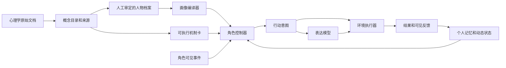

# RoleSimulationFramework

把心理学整理的心智建模库与决策机制库，转译为**可审阅的人物档案、按事件调用的机制、带证据的状态更新与角色行动**。

这是研究原型 v0.1。已提供人物编译、可见性隔离、五张机制卡、两个角色基于背景自主对话的环境、轨迹记录与模型接口。尚未证明对真人行为的预测有效性，也不是 PersonaForge 的复现或改进结果。

## 先看什么

- [设计方案：如何用两份库构建角色模拟](docs/01-design.md)
- [心理学与工程的交付接口、人物填写和机制卡模板](docs/02-authoring.md)
- [与 PersonaForge 的关系及证据范围](docs/03-personaforge.md)
- [评测方案与当前验证记录](docs/04-evaluation.md)
- [GitHub、本机与服务器同步](docs/05-github-server.md)
- [模块划分与实现计划](docs/06-plan.md)
- [当前架构与实现总结（含图示）](docs/07-architecture.md)
- [人格 skills 调研与路线选择](docs/08-persona-skills-survey.md)
- [时间轴与打断：设计说明](docs/09-timeline-and-interruption.md)

## 基本思路



两份原文保存在 `data/sources/`，作为参考资料处理。其中的指令性文字不获得程序执行权限。`data/catalog.json` 为可复建的章节索引，含文档哈希与原文行号。索引中的 `reference_only` 不等于已经实现。

## 无 API 的运行方式

要求 Python 3.11+。运行时仅使用标准库，不需要先安装依赖；请在仓库根目录执行。

```bash
python3.11 -m unittest discover -s tests -v
python3.11 -m rolesim list                       # 角色 role1、role2；剧情 test1、test2
python3.11 -m rolesim validate role1
python3.11 -m rolesim compile role1 --out outputs/role1-views.json
python3.11 -m rolesim run --roles role1 role2 --scene test1      # → runs/<时间>_test1_mock/
python3.11 -m rolesim run --roles role1 role2 --scene test2
# 两个角色都不注入 skill 的对照
python3.11 -m rolesim run --roles role1 role2 --scene test1 --no-skills
python3.11 -m rolesim readable runs/<运行目录>   # 重新生成 transcript.md
```

一个角色一个文件：`roles/role1.json` 里是人物档案（persona schema 2.0，原样嵌入）、skill 列表和开场设定（目标、想透露 / 想隐瞒、前情提要）。一个剧情一个文件：`scenes/test1.json` 只写共享背景和两个座位，没有剧本，不给角色下指令；之后怎么谈由两个角色自己决定。都用编号命名，具体内容打开文件看；见 [docs/02-authoring.md](docs/02-authoring.md)。skill 库在 `library/skills/`。

运行目录默认是 `runs/<YYYYMMDD-HHMMSS>_<剧情>_<模型>/`，时间取 `TZ` 指定的本地时间（本机为北京时间），按名字排序就是按时间排序；`--out` 可指定其他路径。同一路径已有运行结果时程序拒绝覆盖。旧格式（单角色、事件脚本）的运行放在 `runs/legacy/`。

示例采用虚构人物和人工设定参数：role1（林澄）坐项目组一方，role2（周越）坐合作方一方。`mock` 按关键词标线索、根据候选顺序选择行动、用固定台词表达，**只能用于工程验证**。两个人物的输出不同并不构成心理有效性证据。

## 接服务器模型

当前支持提供 `/chat/completions`、JSON object 输出的兼容接口。每次发言三类请求：对收到的话做感知评价、决策、表达；默认 8 次发言约 25 次请求。思考模式保持开启：服务端返回的推理内容只写进运行记录（`audit.jsonl` 的 `reasoning`），不进入任何提示。`ROLE_SIM_MAX_TOKENS`（默认 8192，含推理）与 `ROLE_SIM_TIMEOUT`（默认 600 秒）可调。不支持此协议的提供方需要另写适配器。

```bash
export ROLE_SIM_BASE_URL='http://127.0.0.1:8000/v1'
export ROLE_SIM_MODEL='your-served-model-name'
# 仅在需要鉴权时，通过服务器环境安全注入 ROLE_SIM_API_KEY
python3.11 -m rolesim run --backend chat --roles role1 role2 --scene test1 > /tmp/run.log 2>&1 &   # 目录名会先打印到日志
```

`.env.example` 只提供变量说明，程序不会自动读取 `.env`。远程地址要求 HTTPS，本机回环地址允许 HTTP。请求失败或输出不合法即停止并记录失败，不会静默切回 mock。

## 运行产物

| 文件 | 内容 | 用途 |
|---|---|---|
| `transcript.md` | 运行结束（成功或失败）后自动生成的可读版：概况、背景、两个角色的设定、逐句对话（每句前的感受、选的动作和理由、紧张与信任的变化，折叠的思考过程）、结果汇总 | 人工阅读；含双方的私有设定，不能放进评审包 |
| `manifest.json` | 开始 / 结束时间，座位与角色、场景与机制哈希，模型与采样、模式、调用数、完成/失败状态；每个角色的画像哈希与 skill 信息 | 复核本次运行的配置与证据范围 |
| `public.jsonl` | 开场旁白与双方台词（含各自选的动作） | 读对话 |
| `environment_events.json` | 环境产生的全部合同 Event | 系统侧复现 |
| `audit_report.json/.md` | 两个角色的自动审计汇总 | 一眼看是否通过 |
| `roles/<id>/inputs.json` | 该角色的输入快照（画像、座位、开场设定、场景含世界私有数据） | 系统侧复现，不能提供给另一角色或行为裁判 |
| `roles/<id>/views.json` | 系统真值、角色自知、他者可见、控制器行为约束 | 检查画像编译结果 |
| `roles/<id>/audit.jsonl` | 每轮感知评价、决策与表达的输入输出、推理内容、ProposedAction、两个 StateDelta、状态 | 开发与机制检查，不能混入行为表现评分 |
| `roles/<id>/state.json`、`states.jsonl` | 最新与逐次 AgentState，按 state_id 串链 | 检查状态延续、回放 |
| `roles/<id>/mechanism_log.jsonl`、`audit_report.*` | 机制轨迹；该角色的审计 | 复核 |

`runs/`、`outputs/`、密钥与本地环境文件不进入 Git。版本控制保存源码、来源文档、模板和实验配置；大规模实验结果单独管理。

## 已实现与下一步

| 模块 | v0.1 状态 |
|---|---|
| 两份心理学库 | 原文快照 + 196 个带来源章节索引 |
| 人物编码 | 档案 schema 2.0：`identity` / `traits`（八个子对象）/ `values` / `core_goals` / `speech_style`，每个稳定模块有 status（active / unknown / not_modeled 等）和来源；主人格只执行 P1（30 分面），P2/P3 等三方案比较设计；旧 1.0 档案会被拒绝，不做静默转换 |
| 条件化提示 | 四个重点分面 + 核查偏好 + 表达直接性 + 档案里的情境表达规则；其余分面保留但尚未自动投影 |
| 需要/价值/目标 | 动机基线为稀疏权重；价值为施瓦兹 19 项权重（和为 1，未列出的价值是 unknown 而非 0，可带冲突阈值与可让步范围）；`core_goals` 1–3 个主目标带优先级、稳定度、来源和至多两个支持子目标。三者供控制器参考，未实现目标计算与价值冲突求解 |
| 依恋 | 保存基线，尚未实现关系特异激活 |
| 社会心智 71 维 | 缺少原引用定义，模块状态为 not_modeled；校验拒绝把它设为 active，未伪造维度与能力分数 |
| 机制 | 核查、事件评价、信任、修复、边界五张卡；参数为待校准工程假设 |
| 人格 skills | `library/skills/` 下 9 个兼容 Agent Skills 规范的 SKILL.md（决策、表达、披露三类）；人物在角色文件的 `skills` 里列出并给优先级；运行时三级加载：目录（名称 + 描述）→ 按角色感知到的线索或开场设定激活的正文进入决策提示 → 只有"表达要点"进入表达提示。skill 不写状态。内容为工程侧拟写，待心理学组审定 |
| 开场设定 | 角色文件里的 `setup`：交互目标、想让对方知道的信息、不想让对方知道的信息（只允许遗漏或战略模糊）、前情提要。隐瞒内容只进决策提示，表达提示拿不到原文；审计按关键词检查是否泄露 |
| 记忆 | 本地、仿 Mem0 的只增记忆：前情提要固定在前，较早条目按与当前事件和目标的相似度及显著性召回，最近 12 条完整保留；短剧本下与全量历史一致。未接入 Mem0 服务本身 |
| 状态 | state-v1：六个状态域、模块状态枚举（active / unknown / not_modeled 等）、11 个更新算子的写权限、按依赖组原子提交、硬错/软错/豁免三级处理、`mechanism_log` 与四类版本号；当前更新规则只写紧张（`affect_state.emotion.intensity`）与对合作方的信任，其余模块为 unknown 或 not_modeled，规则卡数值待心理学组交付 |
| 环境 | 已按环境组合同 v0 实现 `Agent.step` / `perceive`；对话环境只给背景、轮流转发双方台词，不写剧本、不编造结果；目前支持两个座位，三方以上与时间轴 / 打断待实现 |
| 感知评价 | 对方的话不带环境标注，角色先由模型从自身立场评价感到哪些线索（五种、0–1），程序校验后按原公式更新状态；话语不改变信任 |
| 模型接口 | 评价、决策、表达三类调用；已用本地 vLLM + Qwen3-8B（思考模式）跑通两角色对话 |
| 对照入口 | `--mode` 三档：`profile_only`（相同历史，不注入状态与机制）、`profile_state`（加动态状态）、`profile_state_mechanisms`（再加机制卡，默认）。状态在三档下都计算并记录，档位只决定控制器提示内容；尚无对照效果结果 |
| 评审包 | `python3.11 -m rolesim package RUN... --out DIR` 导出盲化样本包，每个运行里的每个角色是一个盲化单元：评测版样本、角色可见轨迹、对方真实状态与开场设定（仅供对照）、角色开场设定（简报与已绑定 skill）、标注模板；方法标签（含是否启用 skill）只在 `blind_key.json`。评测协议尚未冻结 |
| 自动审计 | 每次运行按角色产出审计（字段有效性、证据与可见性、写权限、stable 一致、轨迹可追溯、隐瞒信息未泄露、对方秘密与世界私有数据未进入本角色的任何调用），可用 `python3.11 -m rolesim audit <run_dir>` 重审；通过不代表心理有效 |
| GitHub CI | 已提供工作流；执行结果以实际仓库 Actions 为准 |

下一步优先让心理学同学审定少量“人物—触发—行为锚点”样例，再接真实模型做反事实情境对照。不要先把全部理论变成一张任意赋值的大表。
