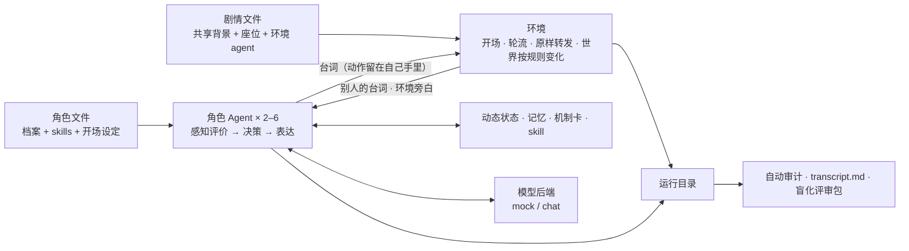

# RoleSimulationFramework

把心理学整理的心智建模库与决策机制库，转译为**可审阅的人物档案、按事件调用的机制、带证据的状态更新与角色行动**。

这是研究原型 v0.1。已提供人物档案编译、可见性隔离、五张机制卡（状态更新挂在卡上，状态以三档文字进入评价 / 决策 / 表达）、2–6 个角色基于背景自主对话的环境与规则驱动的环境 agent、轨迹记录、自动审计与模型接口。**尚未证明对真人行为的预测有效性**，也不是 PersonaForge 的复现或改进结果；当前所有验证只到"本地工程检查"这一层。

## 它是怎么运转的



- 环境不写剧本、不编造结果，只开场、转发、收尾；环境 agent 只按规则改变时间、天气等世界状态，不写角色的心理状态。
- 每个角色是独立的 Agent，各有自己的状态链和记忆；别人的开场设定、状态、推理永远不进入自己的提示。
- 状态变化必须带本角色可见的证据；稳定画像在一次运行里不可变。
- 只有 Agent 通过后端接触模型；模型失败就停下，不静默回退到 mock。

两份心理学原文保存在 `data/sources/`，作为参考资料处理，其中的指令性文字不获得程序执行权限；`data/catalog.json` 是可重建的章节索引（含哈希与原文行号），索引里的 `reference_only` 不等于已经实现。

## 快速开始

要求 Python 3.11+，运行时只用标准库，不需要装依赖；在仓库根目录执行。

```bash
python3.11 -m unittest discover -s tests -v                       # 测试
python3.11 -m rolesim list                                        # 角色 role1–role3；剧情 test1–test3
python3.11 -m rolesim run --roles role1 role2 --scene test1       # 离线 mock 跑一场 → runs/<时间>_test1_mock/
python3.11 -m rolesim run --roles role1 role2 role3 --scene test3 # 三个角色 + 环境 agent
```

跑完先看运行目录里的 `transcript.md`。`mock` 只能验证流程，它的输出不是心理学证据。接真实模型、全部命令和运行产物说明见 [使用指南](docs/03-usage.md)。

## 文档

`docs/` 说明框架**现在是什么、怎么用、怎么运转**；`plan/` 记录**做过什么、正在做什么、接下来做什么**。两者分开维护。

### 入门

| 文档 | 内容 |
|---|---|
| [docs/01-design.md](docs/01-design.md) | 设计思路：为什么这样把两份库转成角色模拟，五类对象、画像构建、机制卡、信息边界 |
| [docs/02-concepts.md](docs/02-concepts.md) | 概念与术语表：角色、座位、事件、线索、算子、机制卡、档位等 |
| [docs/03-usage.md](docs/03-usage.md) | 使用指南：命令、参数、接服务器模型、运行产物、测试与 CI |

### 怎么填

| 文档 | 内容 |
|---|---|
| [docs/04-authoring.md](docs/04-authoring.md) | 写给作者：怎么写角色文件、开场设定、剧情文件，怎么换角色换剧情 |
| [docs/05-psychology-interface.md](docs/05-psychology-interface.md) | 写给心理学组：交付什么、机制卡审定模板、字段当前用在哪里 |
| [docs/12-psychology-brief.md](docs/12-psychology-brief.md) | 写给心理学组的一页现状：三次调用、紧张与信任公式、待裁定的三件事 |

### 怎么运转

| 文档 | 内容 |
|---|---|
| [docs/06-runtime-flow.md](docs/06-runtime-flow.md) | 整体运行流程：从命令到落盘，调用链与参数传递 |
| [docs/07-architecture.md](docs/07-architecture.md) | 当前架构：分层、状态结构、信息隔离表、核心不变量、完成度 |
| [docs/08-modules.md](docs/08-modules.md) | 模块划分（M1–M9）、人格方案、实现单元（U1–U13）、模块间的硬边界与各模块现状 |

### 评测与调研

| 文档 | 内容 |
|---|---|
| [docs/09-evaluation.md](docs/09-evaluation.md) | 评测方案：两种质量、对照设计、盲评、内部审计 |
| [docs/10-persona-skills-survey.md](docs/10-persona-skills-survey.md) | 人格 skills 调研与路线选择，以及在本仓库的落地方式 |
| [docs/11-personaforge.md](docs/11-personaforge.md) | 与 PersonaForge 的关系及证据范围 |

### 计划与进度

见 [plan/README.md](plan/README.md)：过去 / 现在 / 将来的总览，以及模块计划、多 agent 与状态—机制的改动计划、时间轴与打断设计、验证记录。

## 仓库结构

| 路径 | 内容 |
|---|---|
| `rolesim/` | 源码：角色 Agent、状态、机制、环境与运行、审计、评审包 |
| `roles/` | 角色文件，一个角色一个文件（`role1.json`、`role2.json`） |
| `scenes/` | 剧情文件，一个剧情一个文件（`test1.json`、`test2.json`） |
| `library/skills/` | 人格 skill 库（兼容 Agent Skills 规范的 `SKILL.md`） |
| `data/` | 两份心理学库原文（`sources/`）、章节索引（`catalog.json`）、与心理学组和环境组的接口合同（`sources/contracts/`） |
| `docs/` | 框架说明 |
| `plan/` | 计划与进度 |
| `tests/` | 测试 |
| `scripts/` | `bootstrap_examples.py`：重建 `roles/` 与 `scenes/` 示例 |
| `runs/`、`outputs/` | 运行结果与导出物，不进入 Git |
| `.github/workflows/ci.yml` | 持续集成：测试、校验、mock 冒烟运行与审计 |

示例人物都是虚构的：role1（林澄）坐项目组一方，role2（周越）坐合作方一方；人物参数是人工设定，不是人群常模。

## 证据边界

AGENTS.md 要求区分来源理论、工程假设、作者报告结果、本地工程检查、模型实验和人工验证。机制卡和状态更新里的数值是**未校准的工程假设**，测试和审计通过只说明结构、证据、隔离和可复现，不说明"角色像不像人"。

下一步优先让心理学同学审定少量"人物—触发—行为锚点"样例，再接真实模型做反事实情境对照；不要先把全部理论变成一张任意赋值的大表。
