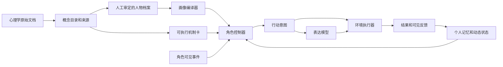

# RoleSimulationFramework

把心理学整理的心智建模库与决策机制库，转译为**可审阅的人物档案、按事件调用的机制、带证据的状态更新与角色行动**。

这是研究原型 v0.1。已提供人物编译、可见性隔离、五张机制卡、四轮脚本环境、轨迹记录与模型接口。尚未证明对真人行为的预测有效性，也不是 PersonaForge 的复现或改进结果。

## 先看什么

- [设计方案：如何用两份库构建角色模拟](docs/01-design.md)
- [心理学与工程的交付接口、人物填写和机制卡模板](docs/02-authoring.md)
- [与 PersonaForge 的关系及证据范围](docs/03-personaforge.md)
- [评测方案与当前验证记录](docs/04-evaluation.md)
- [GitHub、本机与服务器同步](docs/05-github-server.md)

## 基本思路



两份原文保存在 `data/sources/`，作为参考资料处理。其中的指令性文字不获得程序执行权限。`data/catalog.json` 为可复建的章节索引，含文档哈希与原文行号。索引中的 `reference_only` 不等于已经实现。

## 无 API 的运行方式

要求 Python 3.11+。运行时仅使用标准库，不需要先安装依赖；请在仓库根目录执行。

```bash
python3.11 -m unittest discover -s tests -v
python3.11 -m rolesim validate examples/cautious.json
python3.11 -m rolesim compile examples/cautious.json --out outputs/cautious-views.json
python3.11 -m rolesim run --persona examples/cautious.json --out runs/cautious-demo
python3.11 -m rolesim run --persona examples/assertive.json --out runs/assertive-demo
```

同一路径已有运行结果时程序拒绝覆盖。省略 `--out` 可生成 UTC 时间戳目录。

示例采用虚构人物和人工设定参数。`mock` 根据候选顺序选择行动、用固定台词表达，**只能用于工程验证**。两个人物的输出不同并不构成心理有效性证据。

## 接服务器模型

当前支持提供 `/chat/completions`、JSON object 输出的兼容接口。每个可见事件两次请求：决策、表达。四轮示例共八次请求。不支持此协议的提供方需要另写适配器。

```bash
export ROLE_SIM_BASE_URL='http://127.0.0.1:8000/v1'
export ROLE_SIM_MODEL='your-served-model-name'
# 仅在需要鉴权时，通过服务器环境安全注入 ROLE_SIM_API_KEY
python3.11 -m rolesim run --backend chat --out runs/model-first
```

`.env.example` 只提供变量说明，程序不会自动读取 `.env`。远程地址要求 HTTPS，本机回环地址允许 HTTP。请求失败或输出不合法即停止并记录失败，不会静默切回 mock。

## 运行产物

| 文件 | 内容 | 用途 |
|---|---|---|
| `manifest.json` | 人物、场景、机制哈希，模型、模式、调用数、完成/失败状态 | 复核本次运行的配置与证据范围 |
| `inputs.json` | 输入快照，包括环境私有数据 | 系统侧复现，不能提供给角色或行为裁判 |
| `views.json` | 系统真值、角色自知、他者可见、控制器行为约束 | 检查画像编译结果 |
| `audit.jsonl` | 每轮模型输入、决策、thought、ProposedAction、step/perceive 两个 StateDelta、裁决事件、状态 | 开发与机制检查，不能混入行为表现评分 |
| `public.jsonl` | 公开事件与外显行动/话语 | 为后续盲评准备公开轨迹；有私有信息场景需另配角色可见评审包 |
| `state.json` | 最新 AgentState（state_id、prev_state_id、stable、dynamic、memory） | 检查逐轮状态延续 |
| `states.jsonl` | 每次 step/perceive 后的 AgentState 快照，按 state_id 串链 | 按状态链复核与后续回放 |
| `environment_events.json` | 脚本环境产生的全部合同 Event，含私有事件 | 系统侧复现，不能提供给角色或行为裁判 |

`runs/`、`outputs/`、密钥与本地环境文件不进入 Git。版本控制保存源码、来源文档、模板和实验配置；大规模实验结果单独管理。

## 已实现与下一步

| 模块 | v0.1 状态 |
|---|---|
| 两份心理学库 | 原文快照 + 196 个带来源章节索引 |
| 人物编码 | 一套 P1、30 分面及显式来源校验；P2/P3 暂不执行 |
| 条件化提示 | 四个重点分面 + 核查偏好 + 表达直接性；其余分面保留但尚未自动投影 |
| 需要/价值 | 稀疏人工示例字段供控制器参考，未实现完整目标计算 |
| 依恋 | 保存基线，尚未实现关系特异激活 |
| 社会心智 71 维 | 缺少原引用定义，显式待接入；未伪造维度与能力分数 |
| 机制 | 核查、事件评价、信任、修复、边界五张卡；参数为待校准工程假设 |
| 状态 | 合同 state-v0 的 dynamic 五块结构 + StateDelta 硬约束校验；当前规则只更新紧张（emotion.intensity）与对合作方的信任，带来源可见记忆 |
| 环境 | 已按环境组合同 v0 实现 `Agent.step` / `perceive`；脚本环境是其中一种裁决器（单焦点角色 + 有限动作 + 四轮反馈）；多角色调度与自由多智能体环境待实现 |
| 模型接口 | 两阶段兼容接口；已做本机 HTTP 模拟测试，真实模型待接入 |
| 对照入口 | `--mode profile_only`；有相同历史但不注入机制和计算状态，尚无对照效果结果 |
| GitHub CI | 已提供工作流；执行结果以实际仓库 Actions 为准 |

下一步优先让心理学同学审定少量“人物—触发—行为锚点”样例，再接真实模型做反事实情境对照。不要先把全部理论变成一张任意赋值的大表。
