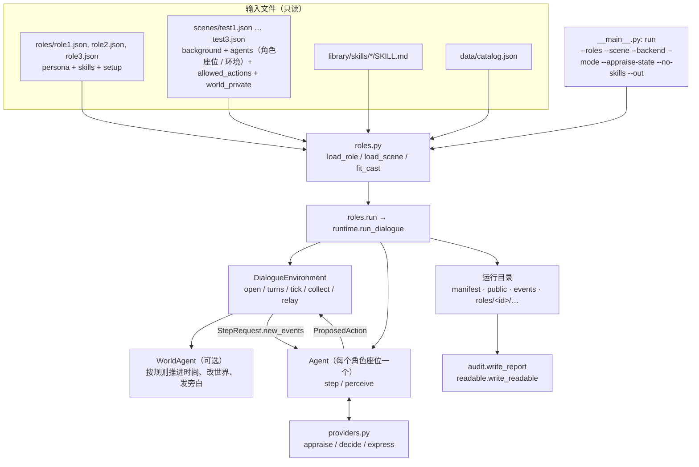
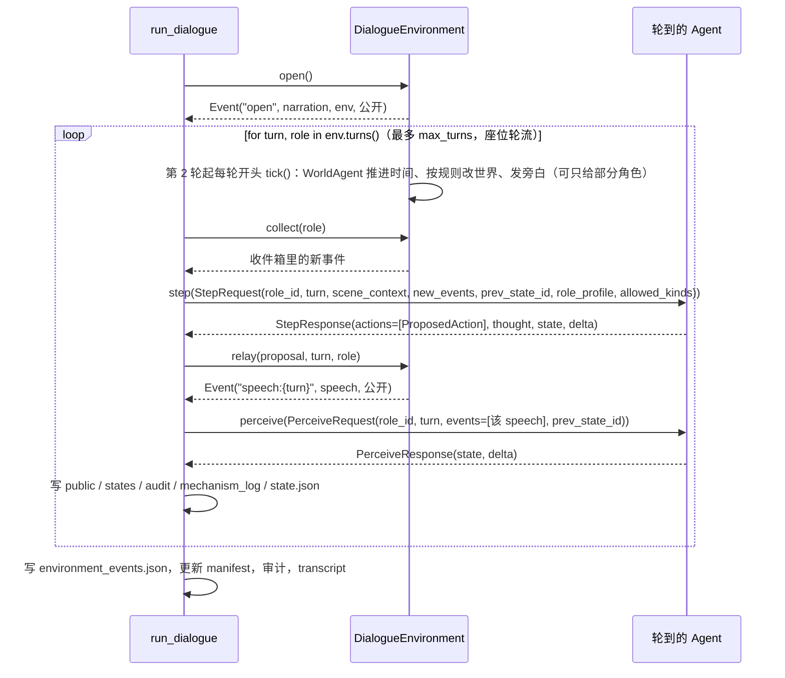
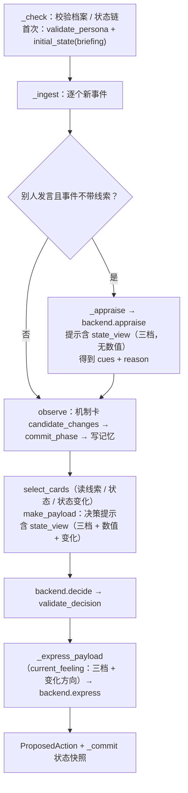

# 整体运行流程：从命令到落盘

本文档回答一个问题：执行一次 `python -m rolesim run` 时，**哪些文件参与、函数怎么一层层调用、关键参数怎么传递、最后落下什么**。它是调用链视角；分层和隔离规则见 [07-architecture.md](07-architecture.md)，输入文件怎么写见 [04-authoring.md](04-authoring.md)，命令与后端配置见 [03-usage.md](03-usage.md)，术语见 [02-concepts.md](02-concepts.md)。实现进度与计划见仓库根目录的 [plan/](../plan/README.md)。

描述对应 2026-10-20 晚的代码（plan/02 落地后）：2–6 个角色按座位顺序依次发言，可选一个按规则改变世界的环境 agent；每个角色每次发言 3 次模型调用；状态由机制卡更新，并以三档文字进入三处提示。

## 1. 一张图



## 2. 文件地图

### 2.1 输入

| 文件 | 内容 | 谁读它 |
|---|---|---|
| `roles/<id>.json`（`role-1.0`） | `persona`（schema 2.0 档案）、`skills`（名称 / 优先级 / 理由）、`setup`（开场设定：`goal`、`disclose`、`conceal`、`recap`） | `roles.load_role` |
| `scenes/<id>.json`（scene 3.0） | `background`、`agents`（2–6 个 `kind: "role"` 座位，至多 1 个 `kind: "environment"`，后者带 `world` 与 `rules`）、`max_turns`、`allowed_actions`、`world_private` | `roles.load_scene` |
| `library/skills/<name>/SKILL.md` | 人格 skill：描述、决策要点、表达要点、不会做的事 | `skills.load_library` |
| `data/catalog.json`、`data/sources/` | 两份心理学库的章节索引与哈希；档案里的 `source_ref` 必须能在这里查到 | `catalog.py`、`skills.py` |

文件名必须等于里面的 `id`（`role1.json` 里 `persona.id` 就是 `role1`）。

### 2.2 代码

| 文件 | 在流程中的位置 |
|---|---|
| `__main__.py` | 命令行入口，解析参数、选后端、生成运行目录名 |
| `roles.py` | 读取并校验两类输入；`fit_cast` 检查搭配；`run` 组装后交给 `run_dialogue` |
| `runtime.py` | `validate_scenario`（scene 3.0）、`WorldAgent`（规则驱动的环境 agent）、`DialogueEnvironment`（开场、轮流、环境 tick、转发）、`make_agent`、`run_dialogue`（主循环与落盘） |
| `contract.py` | 与环境组约定的数据类：`Event`、`Visibility`、`ProposedAction`、`StepRequest/Response`、`PerceiveRequest/Response` |
| `agent_api.py` | 接口定义 v1（[Agent接口定义_v1.md](../data/sources/contracts/Agent接口定义_v1.md)）：`CharacterView` 等类型、校验函数、`split` / `deliveries` / `environment_history` |
| `adapter.py` | `RoleAgentAdapter`：在接口定义 v1 的 `act` / `perceive` 后面，每个角色一个有状态的 `Agent`；只把没见过的记录转成事件交给它 |
| `cognition.py` | 把角色状态写成五段认知文字（模板，不调模型） |
| `loop.py` | 本地参考运行器 `LocalRunner`、环境替身 `EchoEnvironment`、`run_agent_api`（`--interface agent-api`） |
| `agent.py` | `Agent.step` / `perceive`；感知评价、状态更新 `observe`、决策与表达的提示组装与校验 |
| `persona.py` | `validate_persona`、`compile_views`（系统真值 / 角色自知 / 他者可见 / 控制器约束） |
| `state.py`、`modules.py` | 动态状态结构、11 个算子写权限、`commit_phase` 原子提交、模块状态 |
| `mechanisms.py` | 5 张机制卡（card schema 2.0：触发条件 / 状态效果 / 动作倾向）、两条状态规则 `tension_v1` / `trust_v1`、`candidate_changes`、`triggered`、`select_cards` |
| `stateview.py` | `state_view`：把动态状态换成"低 / 中 / 高"三档文字，加上自上次发言以来的净变化，供三处提示使用 |
| `skills.py`、`briefing.py`、`memory.py` | skill 绑定与激活；开场设定的决策视图 / 表达视图；记忆写入与召回 |
| `providers.py` | `MockBackend`、`ChatBackend`，各有 `appraise` / `decide` / `express` |
| `vocab.py` | 7 个交流动作（`ACTION_TEXT`）与 5 种线索（`CUE_TEXT`） |
| `audit.py`、`readable.py`、`package.py` | 自动审计、可读版 `transcript.md`、盲化评审包 |

### 2.3 输出（一次运行一个目录，默认 `runs/<YYYYMMDD-HHMMSS>_<剧情>_<模型>/`）

```
manifest.json            配置、版本、哈希、调用数、状态、审计结论
public.jsonl             开场旁白、环境旁白（带 audience）、各角色台词（含各自选的动作）
environment_events.json  环境产生的全部 Event（含只给部分角色的私有旁白）
world.jsonl              环境 agent 每轮的世界状态（有环境 agent 时）
audit_report.json/.md    各角色自动审计
transcript.md            可读版（含私有设定，不能进评审包）
roles/<id>/
  inputs.json            该角色的输入快照
  views.json             compile_views 的结果
  audit.jsonl            每次发言的评价/决策/表达输入输出、推理、两个 delta
  states.jsonl           状态快照链（每次发言两个：听完、说完）
  state.json             最新状态
  mechanism_log.jsonl    状态更新的候选、采纳、拒绝
  audit_report.json/.md  该角色审计
```

## 3. 阶段一：加载与检查（`__main__` → `roles.py`）

```
python -m rolesim run --roles role1 role2 --scene test1 [--backend mock|chat] [--mode ...] [--appraise-state on|off] [--no-skills] [--out DIR]
python -m rolesim run --roles role1 role2 role3 --scene test3      # 三个角色 + 环境 agent
```

1. `load_role(ref)` → `{id, path, file, persona, binding, bound, setup}`
   - 读 JSON，`validate_role`：`persona` 过 `validate_persona`；`skills` 非空时 `skills.bind(binding, persona_id, library)`；`setup` 过 `validate_briefing`。
   - `binding` 是 `{schema_version, persona_id, skills}`；`bound` 是和 SKILL.md 合并后的完整 skill 列表。
2. `load_scene(ref)` → `{id, path, scenario}`，过 `validate_scenario`（scene 3.0；角色座位 2–6 个、环境 agent 至多 1 个且规则合法、动作必须在 `vocab.ACTIONS` 里等；2.0 场景被拒绝，不静默转换）。
3. `backend = MockBackend() if --backend mock else ChatBackend()`；`ChatBackend` 读环境变量 `ROLE_SIM_BASE_URL`、`ROLE_SIM_MODEL` 等。
4. 运行目录：`--out` 或 `runs/` + `runtime.run_name(scene_id, model)`；目录已存在则拒绝。
5. `roles.run(roles, scene, backend, output, mode, use_skills, appraise_state)`：
   - `fit_cast(roles, scene)`：座位数、角色是否重复、`mechanism_priors` 与机制卡 id 是否一致、角色的 skill 在这个剧情里是否可能被激活（只给 `notes`，不拦截）。
   - 拼出 `cast = [{persona, skills(binding), briefing(setup)} …]`，连同 `scenario`、`origin`（角色与剧情文件哈希）交给 `run_dialogue`。

## 4. 阶段二：装配（`runtime.run_dialogue`）

```python
run_dialogue(cast, scenario, backend, output, mode, use_skills, origin, appraise_state)
```

- `ids = [persona.id …]`（座位顺序）。
- `env = DialogueEnvironment(scenario, ids)`：
  - `titles[role]`：座位名；`log`：全部事件；`inbox[role]`：待收事件；`closed_by`；
  - `world`：场景有环境 agent 时是一个 `WorldAgent`（世界变量 `time` / `weather` / `place` / `noise`，规则 `minutes_per_round`、`announce_time`、`events`）。
- 每个角色座位 `make_agent(persona, scenario, backend, seat, cast, mode, bound, use_skills, briefing, appraise_state)`：
  - 再校验一次档案与简报；
  - `Agent(backend, allowed_actions, others={其他角色 id: 座位名}, mode, skills=bound 或 None, briefing, seat=自己座位名, appraise_state)`。
- 写 `manifest.json`（状态 `running`，含 `appraise_state`、`environment`）、`roles/<id>/inputs.json`（含机制卡快照 `mechanisms = {schema, cards}`）、`views.json`，打开 `audit` / `states` / `mechanism_log` 三个 jsonl。

此时 Agent 里还没有档案：`persona` 和 `state` 要等第一次 `step` 收到 `role_profile` 才建立（合同要求）。

## 5. 阶段三：主循环



要点：

- 轮到谁由 `env.turns()` 决定：`cast[(turn-1) % 角色数]`，固定按场景里的座位顺序；`closed_by` 被设置后停止。一"轮"（round）是所有角色各说一句。
- 环境 agent 只在第 2 轮起每轮开头行动：事件 id `world:{轮}:time`（报时）与 `world:{轮}:{k}`（规则事件），类型 `narration`、发出者 `env`；规则写了 `audience`（座位 id）时可见性为 `private`，只进这些角色的收件箱。规则事件可带 `cues`，角色直接用这些线索，不再调用模型评价。环境 agent 没有心理状态，不替角色说话、不裁定角色动作的结果、不写角色的状态。
- `StepRequest.role_profile` 只在该角色第一次发言时传，之后是 `None`；`prev_state_id` 必须与 Agent 手里的最新 `state_id` 一致。
- 台词事件 id 是 `speech:{turn}`，开场是 `open`，环境旁白是 `world:…`；`ProposedAction.proposal_id` 是 `{role}@t{turn:03d}#1`；状态 id 是 `{role}@t{turn:03d}`（听完）和 `{role}@t{turn:03d}.p1`（说完）。
- `relay` 只检查"类型是 speech 且动作标签在 `allowed_actions` 里"；台词对所有在场角色公开，动作标签留在 `intent_note`，**不进事件**，别人只听到台词。动作是 `close` 时设置 `closed_by`。
- 任何一步失败（`status != "ok"`）直接抛出，运行标记 `failed`，不换成 mock 继续。

## 6. `Agent.step` 内部（最核心的一段）



### 6.1 三类模型调用的输入与输出

| 调用 | 提示由谁组装 | 输入的主要键 | 输出 |
|---|---|---|---|
| 感知评价 `appraise` | `agent.appraisal_payload` | `role`（自知）、`behavioral_constraints`、`scene_background`、`self_seat`、`others_present`、`visible_history`（`memory.recall`）、`event`、`cue_definitions`、`briefing`（决策视图）；按档位与 `--appraise-state` 加 `current_state`（只有三档文字） | `{cues:{线索:0–1}, reason}`，`validate_appraisal` 检查线索名与范围 |
| 决策 `decide` | `agent.make_payload` | 同上，加 `respond_to`、`my_previous_actions`、`allowed_actions`、`action_meanings`；按档位与配置加 `skill_catalog` / `active_skills`、`current_state`（三档 + 数值 + `changes_since_my_last_turn`，变化带算子名 `by`）、`active_mechanisms` | `{action, evidence_ids, brief_reason}`，`validate_decision` 检查动作可行、证据可见 |
| 表达 `express` | `Agent._express_payload` | `role`、`style_constraints`（只含 `speech_style.*` 的规则）、`self_seat`、`others_present`、`respond_to`、`action`、`action_meaning`、`my_previous_lines`、`visible_history`、`skill_style`、`disclosure`（只含可透露的内容，不含隐瞒原文）；按档位加 `current_feeling`（三档 + 变化方向，不含数值与算子名） | `{speech}` → 台词字符串，非空且 ≤ 600 字 |

**为什么要有感知评价。** 早期的脚本环境会给事件标注线索（压力、不确定、冲突……），机制卡和 skill 按线索激活，紧张度按压力更新。自由对话里对方的话不带标注，所以角色在决策前先做一次评价：模型站在这个角色的立场，报告它从这句话里感到哪些线索、各多强（0–1）。程序只接受登记过的五种线索和合法范围，再由机制卡的状态规则更新状态；状态变化仍引用这句话的事件 id 作证据。对方的话是"说法"，不是兑现证据，所以不会改变信任（信任只认可核验的兑现 / 失约记录）。事件自带环境标注的线索时（`Event.signals`），直接用标注，不再调用模型评价。

档位（`mode`）决定状态与机制卡出现在哪些提示里：

| `mode` | 评价 `current_state` | 决策 `current_state` | 表达 `current_feeling` | 决策 `active_mechanisms` |
|---|---|---|---|---|
| `profile_only` | 不给 | 不给 | 不给 | 不给 |
| `profile_state` | 给（`--appraise-state off` 时不给） | 给 | 给 | 不给 |
| `profile_state_mechanisms`（默认） | 同上 | 给 | 给 | 给 |

状态在三档下都会计算、记录。三档文字由 `stateview.state_view` 按字段取值范围三等分换算（工程假设，未校准），只列出 active 且有值的字段，变化合并为每个字段一条净变化。skill 与开场设定属于人物，三档都注入（`--no-skills` 除外）。`--appraise-state off` 是对照开关：评价提示不看状态，记入 `manifest.appraise_state`。

### 6.2 可见性与记忆

- `_ingest` 对每个事件二次校验 `role_id in event.visibility.audience`，不在的丢弃并记 `warnings`。
- 事件进入记忆的是 `observation(event, cues, names)`：只含 id、类型、说话人（自己叫"我"，其他角色叫座位名，环境叫"旁白"）、内容、线索。
- 召回 `memory.recall(memory, query)`：前情固定在前，较早条目按相似度取 4 条，最近 12 条完整保留；`query` 是当前事件内容加开场目标。
- 自己的台词要到 `perceive` 时才进入记忆。

### 6.3 skill 与机制卡怎么进决策提示

- `skills.select(bound, observation, allowed, briefing)`：按本轮线索（阈值 0.5）或开场设定里的 `conceal` / `disclose` 激活，最多 3 个；表达要点由 `skills.expression_hints` 单独传给表达提示。skill 不写状态。
- `mechanisms.select_cards(persona, ctx, allowed)`：`ctx = mechanisms.context(...)` 带本轮线索、当前状态、自上次决策以来已提交的变化（`since`）和刚说话的人（`other`）。每张卡的 `trigger.any_of` 可以是线索（`cue`）、状态值（`state`，如紧张 ≥ 0.6667）或状态变化（`delta`，如对此人的信任净降 ≥ 0.05）；满足任一条件即触发，可行动作与 `allowed` 取交集，分数 `强度 × (0.5 + 0.3×人格先验 + 0.2×调节量)`，取前 3。强度：线索 / 状态取观测值，变化取 `|Δ|/0.3`。卡片带 `matched`（满足的条件和观测值），审计会复核。

## 7. 状态怎么更新（`observe` → `commit_phase`）

`agent.observe(state, event, persona, phase, cues, names, since)`：

1. `ctx = mechanisms.context(persona, dynamic, cues, others, other=发言者, since, event)`；`mechanism_log` 里记下 `cards = triggered(ctx)`（哪些卡触发、满足哪些条件、有无状态规则，没有的写 `no_state_rule`）。
2. `candidate_changes(ctx, event_id)`：遍历机制卡的 `effects`。目前两条：
   - `appraise` 卡 → 规则 `tension_v1`：`新 = 旧×(1−恢复率) + gain × 压力线索 × 威胁敏感度`，`gain = 0.35` 写在卡上，恢复率、敏感度来自档案 `affective_capacities`；
   - `trust` 卡 → 规则 `trust_v1`：`新 = 旧 + gain × 兑现信号`，`gain = 0.15`；兑现信号只认 `narration` / `outcome` 事件（`signals.about` 指明对谁，只有一个其他角色时默认是他），别人的话不算，所以纯对话里信任不变。
   - 两条都是 `when: "every_event"` 的连续过程：不论卡是否触发，每个事件都算（没有压力时紧张按恢复率回落）。输入是 `null` 就跳过，不用中性值替代。
3. 候选 `{path, before, after, evidence, group, mechanism, reason, card, rule, when, inputs}`：`card` / `rule` / `inputs` 让审计可以逐条复算。
5. `state.commit_phase(dynamic, module_status, delta, known_ids, commit_key, committed)`：逐条硬检查（证据可见、算子登记、写权限、模块 active、范围、`before` 与快照一致）→ 按 `group` 原子提交 → 返回新状态、采纳的变化、拒绝日志。
6. 采纳与拒绝都追加到 `mechanism_log`；事件写入记忆、`seen_ids`。

`perceive` 走同一个 `observe`（`phase="perceive"`）：自己的台词没有新压力，紧张按恢复率回落。

`_commit` 生成快照：`state_id`、`prev_state_id`、版本号、`stable_snapshot_id`、`stable`（只读）、`dynamic`、`module_status`、`memory`（已见事件 id）。

> 现状限制：状态仍只有紧张和信任两条规则在写，其余三张卡（verify / repair / boundary）没有状态规则；所有阈值、gain 与三档切分都是未校准的工程占位，等心理学组的规则卡替换（见 [plan/06](../plan/06-psychology-decisions.md)）。

## 8. 阶段四：收尾

`run_dialogue` 正常结束后依次：

1. `environment_events.json`、`world.jsonl`（有环境 agent 时）、`manifest.json`（`completed`、`turns`、`closed_by`、`api_calls`、各角色最终状态 id、被拒组数）。
2. `audit.write_report(output)`：从落盘文件重新推导每个角色的审计（含 `state_change_attribution`：每条变化的卡、规则、输入与复算值，以及决策提示里所示机制卡的触发条件），写 `audit_report.*`，结论回写 `manifest["audit"]`。
3. `readable.write_readable(output)`：生成 `transcript.md`；失败只写 `transcript_error.txt`，不改变运行结果。

出错时同样落盘（状态 `failed`、错误类型与信息），并尝试生成 `transcript.md`。

## 9. 运行之后的命令

| 命令 | 入口函数 | 用途 |
|---|---|---|
| `rolesim audit RUN` | `audit.write_report` | 重新审计一个运行 |
| `rolesim readable RUN…` | `readable.write_readable` | 重新生成 `transcript.md` |
| `rolesim package RUN… --out DIR --seed N` | `package.export_package` | 导出盲化评审包（方法标签只在 `blind_key.json`） |
| `rolesim list [--roles … --scene …]` | `roles.fit_cast` | 列出角色和剧情，或检查某组搭配是否可行 |
| `rolesim validate ROLE`、`compile ROLE --out F`、`skills [ROLE]` | `load_role`、`compile_views`、`load_library` | 校验 / 导出视图 / 校验 skill |

## 10. 参数传递速查

| 对象 | 谁产生 | 传给谁 | 关键字段 |
|---|---|---|---|
| role 文件 dict | `roles.load_role` | `roles.run` / `seat` | `persona`、`binding`、`bound`、`setup` |
| scene dict | `roles.load_scene` | `run_dialogue`、`make_agent` | `background`、`agents`、`max_turns`、`allowed_actions` |
| `cast` | `roles.run` | `run_dialogue` | 每个角色座位 `{persona, skills, briefing}` |
| `Event` | 环境（`env.open`、`env.tick`、`env.relay`） | `StepRequest.new_events`、`PerceiveRequest.events` | `event_id`、`actor`、`type`、`content`、`visibility`、`signals` |
| `StepRequest` | `run_dialogue` | `Agent.step` | `role_id`、`turn`、`scene_context`、`new_events`、`prev_state_id`、`role_profile`、`allowed_kinds` |
| `ProposedAction` | `Agent.step` | `env.relay` | `proposal_id`、`kind="speech"`、`content`、`target`、`intent_note`（动作标签） |
| `cues` | `backend.appraise` | `observe`、`skills.select`、`select_cards` | 五种线索各 0–1 |
| `ctx` | `mechanisms.context` | `candidate_changes`、`triggered`、`select_cards` | `cues`、`dynamic`、`others`、`other`、`since`、`event` |
| 状态视图 | `stateview.state_view` | 三处提示的 `current_state` / `current_feeling` | `items`（字段、档位、可选数值）、`changes_since_my_last_turn` |
| 候选变化 / `delta` | `mechanisms.candidate_changes` | `state.commit_phase` | `path`、`before`、`after`、`evidence`、`mechanism`、`group`、`reason`、`card`、`rule`、`when`、`inputs` |
| AgentState 快照 | `Agent._commit` | `StepResponse.state`、`states.jsonl` | `state_id`、`prev_state_id`、`stable`、`dynamic`、`module_status`、`versions` |

## 11. 排查时先看哪里

- 不知道某句话为什么这么说：`transcript.md`，再看 `roles/<id>/audit.jsonl` 里该轮的 `appraisals`、`decision`、`expression_input`。
- 状态为什么没变 / 被拒绝：`roles/<id>/mechanism_log.jsonl` 的 `rejected`。
- 审计没过：`audit_report.md`，每项失败带原因。
- 环境什么时候做了什么：`world.jsonl` 与 `environment_events.json` 里 `world:` 开头的事件。
- 运行失败：`manifest.json` 的 `error_type`、`error`。

## 12. 另一条路径：接口定义 v1（`--interface agent-api`）

环境组的运行器还没写好，这条路径用本地参考运行器按[接口定义 v1](../data/sources/contracts/Agent接口定义_v1.md)跑同样的角色与剧情。角色内部（评价 → 机制卡 → 决策 → 表达、状态链、审计记录）和上面完全相同，只是外面换了一层。

```
loop.run_agent_api
  episode(roles, scene)      角色名 = 人物 name；运行器角色 ID = 剧情座位 ID；背景 → trigger_facts
  LocalRunner.run()          每轮：
    导演指令                  第 1 轮是开场；之后每个大轮开头由 WorldAgent 规则产生（报时、世界事件及其可见范围）
      EchoEnvironment.act    指令原样作为环境 action（环境组实现前的替身）
      split → deliveries     看到的角色各 perceive 一次
    行动者 act               RoleAgentAdapter.act
      validate_action_result → split → 行动者视角直接追加 → 其他看到的角色各 perceive 一次
    行动者的动作是 close 时停止（只在本地；接口还没有结束信号）
```

`RoleAgentAdapter` 每次调用：

1. 校验输入（`agent_api`），同一 `request_id` 重发直接返回缓存结果。
2. 按 `name` 找到角色；第一次见到时建 `Agent`，在场角色从此固定。
3. 视角里没见过的记录（包括自己上一次的发言）转成事件，编号 `action_id#order_index`；自己的思考跳过。
4. `act` 调 `Agent.step`，返回 `{thought: null, speech: 台词, action: null, order: ["speech"]}`；`perceive` 调 `Agent.perceive`。
5. 用 `cognition.project` 把状态写成五段认知返回。运行器传回的认知与上次返回的不一致时只记告警。

出错时抛异常（`AgentCallError`），本次没有提交任何状态，换一个 `request_id` 可以重来。

输出目录：`manifest.json`（`interface: agent-api-v1`）、`records.jsonl`（运行器视角的全部记录）、`calls.jsonl`（每次调用的完整输入与输出）、`roles/<id>/audit.jsonl`、`states.jsonl`、`mechanism_log.jsonl`、`transcript.md`（按记录生成的简版）。这条路径暂不生成 `audit_report`，也不能用 `rolesim package` 打包，因为两者读取的是原路径的目录格式。

