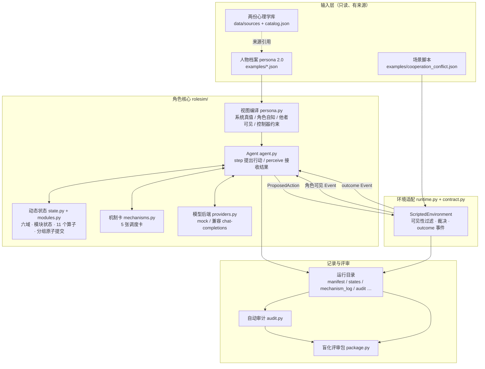
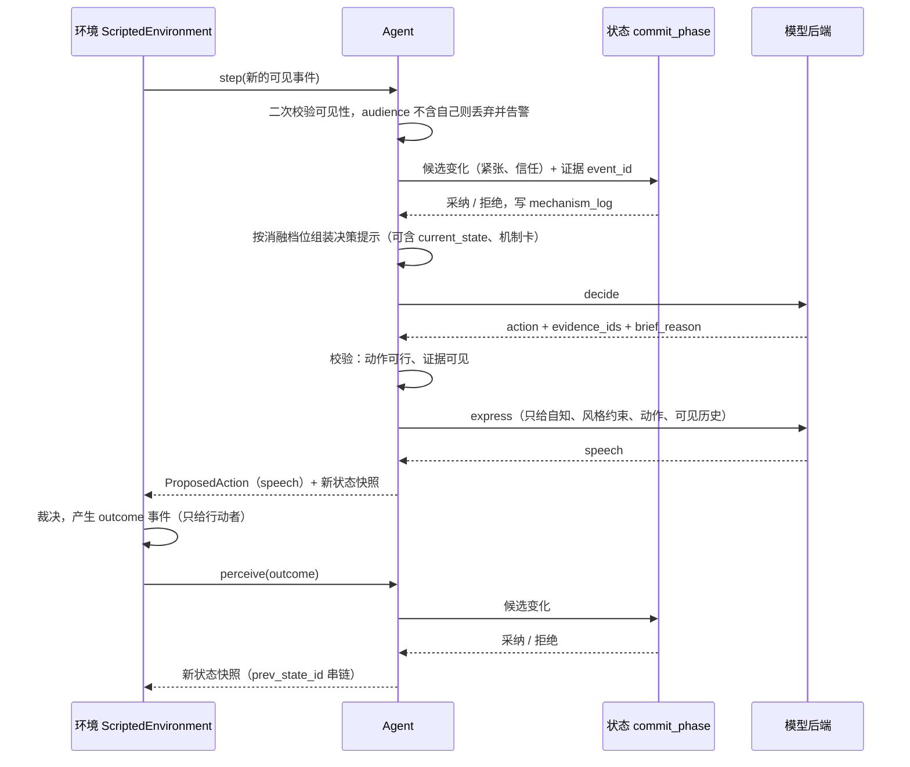
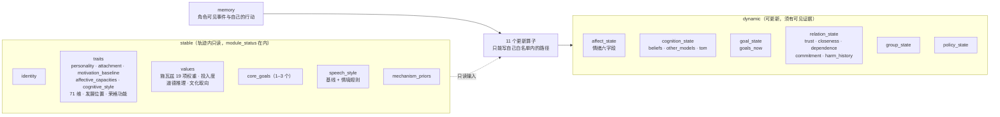
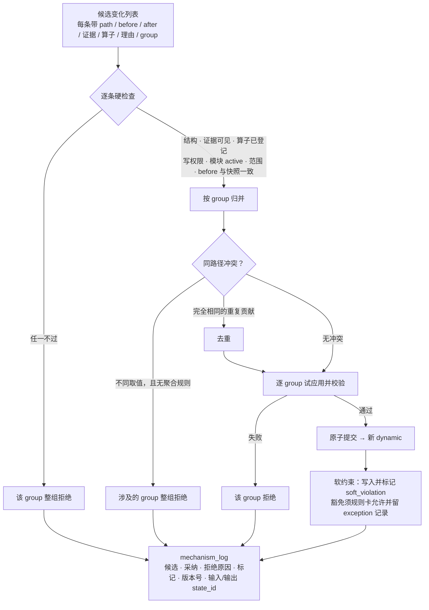
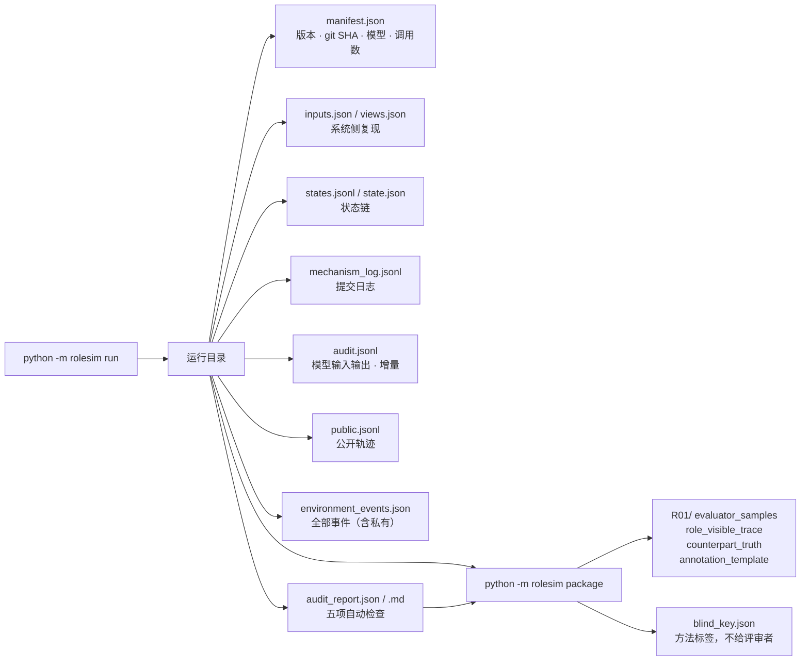

# 当前架构与实现总结

本文档描述 2026-10-19 时仓库里**已经实现**的东西：分几层、数据怎么流、哪些地方做了隔离和校验、哪些还是空的。规划与分工见 [06-plan.md](06-plan.md)，设计动机见 [01-design.md](01-design.md)。

## 1. 一句话概括

把心理学组整理的两份库和回复，落成一条**可审计的数据通道**：人物档案（稳定）→ 角色可见事件 → 带证据的状态更新 → 决策与表达 → 环境裁决 → 全程落盘 → 自动审计 → 盲化评审包。

通道已经打通，并有 96 项工程测试。**心理内容大多仍是空壳**：11 个更新算子只有写权限、没有幅度规则；机制卡数值是未校准的工程假设；真实模型还没跑过。所有验证都是工程层面的，没有心理有效性证据，mock 的输出差异也不能当证据。

## 2. 总体结构



读图要点：

- **环境裁决发生了什么，角色只提出尝试。** `ProposedAction` 被接受、成功与否，都由环境产生的 `outcome` 事件告诉角色。
- **只有 Agent 通过后端接触模型。** 状态、机制、画像编译都能在没有模型的情况下完整校验。
- 虚线表示只是来源引用：`catalog.json` 提供章节索引和哈希，档案里的 `source_ref` 必须指向其中的条目（有测试检查）。

## 3. 分层与代码地图

| 层 | 文件 | 职责 | 状态 |
|---|---|---|---|
| 来源 | `catalog.py`、`data/` | 两份库的快照、章节索引（196 条）、哈希；其中的指令性文字没有执行权限 | 完成 |
| 画像 | `persona.py` | schema 2.0 校验、四种视图编译、条件化行为语句 | 结构完成，仅 P1 |
| 模块状态 | `modules.py` | 六种状态、状态与值一致性检查、转换审计；稳定与动态共用 | 完成 |
| 动态状态 | `state.py` | 六个状态域、11 个算子写权限、`commit_phase`、三级错误、四类版本号 | 结构完成，规则很少 |
| 机制 | `mechanisms.py` | 5 张调度卡、打分、取前 3 | 未校准 |
| 接口合同 | `contract.py` | Event / ProposedAction / AgentState / StateDelta 数据类与校验 | 完成（按环境组合同 v0） |
| 角色 | `agent.py` | `step` / `perceive`、可见性二次校验、决策与表达编排、状态链 | 完成 |
| 后端 | `providers.py` | mock 夹具；兼容 `/chat/completions` 的真实后端，失败不回退 | 完成，真实模型未跑 |
| 环境与运行 | `runtime.py` | 脚本环境、`run_episode`、落盘、git SHA | 单焦点角色 + 四轮 |
| 审计 | `audit.py` | 从落盘产物重新推导五项自动检查 | 完成 |
| 评审包 | `package.py` | 盲化评审包导出 | 完成 |
| 入口 | `__main__.py` | `catalog` `validate` `compile` `run` `audit` `package` | 完成 |
| 示例与重建 | `examples/`、`scripts/bootstrap_examples.py` | 两个虚构人物 + 一个场景 | 虚构设定 |

## 4. 一个事件怎么被处理



要点：

- 每个事件**用同一份已提交快照**生成候选，同一阶段内不读取未提交的候选。
- 决策或表达失败时返回 `status=error`，**状态不前进**，也不会换成 mock 或把内心独白当台词。
- `perceive` 之后下一次 `step` 读取的就是最新状态；`prev_state_id` 不匹配会被拒绝。

## 5. 状态结构



模块状态是贯穿两侧的一套规则：

| 状态 | 含义 | 值的要求 |
|---|---|---|
| `active` | 已启用且有值 | 必须有值，且稳定模块要有来源 |
| `unknown` | 已启用但证据不足 | 必须是 `null`，不能写成 0 或中性值 |
| `not_modeled` / `disabled` | 本版未建模 / 被关闭 | 不得持值，不参与计算 |
| `inactive` / `not_applicable` | 本轮未激活 / 场景不适用 | 不得持值 |

只有 `active` 模块可以被写入。状态转换写入审计记录；重新启用需要完成校验。

目前 `dynamic` 里实际有更新规则的只有两条：紧张（`affect_state.emotion.intensity`）和对合作方的信任（`relation_state.partner.trust`）。

## 6. 候选变化如何提交



- 一个 group 内的变化要么全部生效要么全部不生效；其他 group 不受影响。
- 同一个 `commit_key`（角色/事件/阶段）重试是空操作。
- 硬错**不能被豁免**；目前唯一的软规则（信任单步上限）也不允许豁免，因为还没有规则卡允许。

## 7. 谁能看到什么

| 信息 | 决策提示 | 表达提示 | 评审包·评测版 | 评审包·角色可见版 |
|---|---|---|---|---|
| 自我理解 `self_view` | 是 | 是 | 否 | 否 |
| 条件化行为语句（含表达风格规则） | 是 | 仅 `speech_style.*` 部分 | 否 | 否 |
| 动机基线、价值、核心目标 | 是 | 否 | 否 | 否 |
| 可见历史 | 是 | 是 | 是 | 是（作为轨迹） |
| 当前动态状态 | 仅 `profile_state` 及以上 | 否 | 是（前后状态） | 否 |
| 机制卡与控制器提示 | 仅 `profile_state_mechanisms` | 否 | 否（提示不导出，避免暴露档位） | 否 |
| 模型输出与推理摘要 | — | — | 是 | 否 |
| 世界私有数据、角色不可见事件 | 否 | 否 | 仅在单独的对照文件 | 否 |

**已知缺口：评测版样本目前不带稳定画像**（自我理解、特质、价值、目标）。评"稳定一致性""角色可区分性"需要它，导出时要补，补的时候仍须与方法标签分开。

三档消融入口：`profile_only`（相同历史，不注入状态与机制）、`profile_state`（加动态状态）、`profile_state_mechanisms`（再加机制卡，默认）。**状态在三档下都计算并记录**，档位只改变控制器提示。

## 8. 运行产物与评审链路



- **自动审计**从落盘文件重新推导，不信任引擎自己的记录：字段有效性、证据与可见性、写权限、stable 一致、轨迹可追溯；另外单列软约束、豁免、被拒依赖组、模块覆盖。其余维度只标注"需人工评分"。
- **评审包**每个运行一个盲化编号；模式、后端、模型、代码版本只在 `blind_key.json`。对方真实状态单独成文件，只供对照。
- 每次运行自带四类版本号：`construct_definition_version`（未登记）、`state_schema_version`、`update_rule_version`、`evaluation_protocol_version`（未冻结）。

## 9. 核心不变量

这些由代码或测试强制，而不是约定：

1. `stable` 在一个轨迹内不可变；`StateDelta` 的路径以 `stable` 开头一律拒绝，运行中每轮还用哈希复核。
2. 每条状态变化必须带**本角色可见**的证据，且只能写 `active` 模块、自己算子白名单内的路径。
3. 数值越界直接拒绝，不截断；未知用 `null`，不用中性值代替。
4. 世界私有数据和他人的隐藏心理字段不进入任何模型调用；角色不可见的事件在入口被丢弃。
5. 他人的口头承诺不算"已兑现"的证据，只有叙述事实和环境裁决的结果可以改变可靠性判断。
6. 模型调用失败就停下并记录，**不静默回退 mock**。
7. 旧 schema 的档案和轨迹被拒绝，不做静默转换。

## 10. 完成度与未做

| 方面 | 已有 | 没有 |
|---|---|---|
| 画像 | schema 2.0，20 个稳定模块带状态，P1 30 分面，施瓦兹 19 项，核心目标 | P2/P3 及三方案比较；分面级 unknown；其余 26 个分面的行为投影；71 维；stable 变更的版本迁移结构 |
| 动态状态 | 六域骨架，原子提交，三级错误，日志与版本 | 11 个算子的机制卡数值；信念、目标、他人模型的更新规则；时间事件与衰减规则 |
| 环境 | 单焦点角色 + 四轮脚本 | 多角色调度；真实场景；环境组对合同的回复 |
| 模型 | 两阶段接口、严格 JSON、本机回环不走代理 | 真实模型运行（需要可用的服务） |
| 评测 | 三档消融，自动审计，盲化评审包，标注模板 | 评审包带稳定画像；评测协议冻结；标注工具；复标统计；回放工具；真人基线 |

## 11. 常用命令

```bash
# 项目要求 Python 3.11+（CI 用 3.11）。本机目前只有 python3（3.10.12），测试在 3.10 下也通过，但那不等于 3.11 验证
python3.11 -m unittest discover -s tests -v
python3.11 -m rolesim validate examples/cautious.json
python3.11 -m rolesim run --mode profile_state --out runs/demo
python3.11 -m rolesim audit runs/demo
python3.11 -m rolesim package runs/a runs/b --out outputs/review --seed 1
PYTHONPATH=. python3.11 scripts/bootstrap_examples.py   # 重建示例档案
```

## 12. 证据边界

AGENTS.md 要求明确区分来源理论、工程假设、作者报告结果、本地工程检查、模型实验和人工验证。当前仓库里的结论**只到"本地工程检查"这一层**：结构、证据、隔离和可复现性可以被测试和审计验证，"角色像不像人"没有被验证，也不能由 mock 或审计通过来推出。
