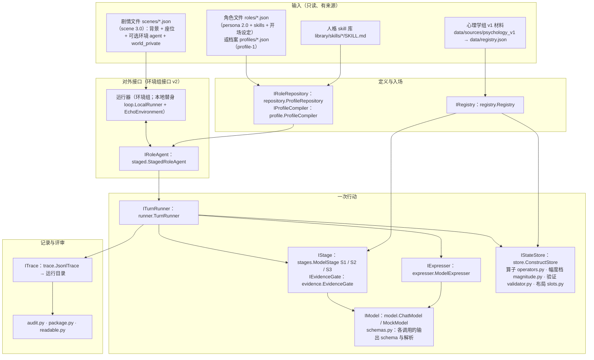

# 当前架构与实现总结

本文描述仓库里**已经实现**的东西：分几层、数据怎么流、哪里做了隔离和校验、哪些还空着。一次运行的调用链见 [06-runtime-flow.md](06-runtime-flow.md)，模块与接口的对应见 [08-modules.md](08-modules.md)，各接口的签名与保证见 [plan/10](../plan/10-interfaces.md)，实现进度见 [plan/](../plan/README.md)。

## 1. 一句话概括

把心理学组的 v1 定义（构念登记、状态说明、变化规则、三个心理流程 skill）落成一条**可审计的数据通道**：角色文件 / 档案 + 剧情文件 → 环境组接口 v2（`initialize` / `act`）→ 每次行动按记录组做事件建模、对上次计划的反馈做长期演化、再做行动计划和表达 → 状态只经登记表授权的算子、在按事件等级定的幅度档内写入 → 全程落盘 → 自动审计 → 盲化评审包。

所有验证都是工程层面的（测试、mock 运行、审计）。没有心理有效性证据；mock 的输出不能当证据；登记表里的数值是心理学组的初始值，未标定。

## 2. 总体结构

读图要点：

- **环境不写剧本。** 本地替身只把导演指令（开场、报时、世界事件）原样作为环境动作发出，并按接收者分发记录；环境 agent 是规则驱动的，没有心理状态。
- **每个角色在每场互动里一个会话。** 各有各的状态链、记忆、轨迹；别人的思考、状态和开场设定永远不进入自己的提示。
- **阶段只提议，状态存储才写。** 写入权限、阶段权限、依赖组都来自登记表；越界拒绝，不截断。
- **轨迹由角色这一侧自己写**，不依赖运行器。

## 3. 代码地图

| 层 | 文件 | 职责 | 状态 |
|---|---|---|---|
| 对外接口 | `agent_api.py` | 环境组接口 v2：`IRoleAgent` / `IEnvironment` 的数据类型、双向校验、记录拆分与可见性 | 完成 |
| | `adapter.py`、`staged.py` | `RoleAgentBase`（选角色、会话、`request_id` 重试、串行）与 `StagedRoleAgent`（第一次行动时入场，之后交给 `TurnRunner`；按角色的消融模式） | 完成 |
| 一次行动 | `runner.py` | `TurnRunner`：记录组 → S1；对上次计划的反馈 → S3；S2（被拒重做一次）；表达；失败后接着做 | 完成 |
| | `evidence.py`、`stages.py`、`expresser.py` | 证据门（可见记录、排除原因、记忆取回）；三个阶段（自知层视图、开场设定、人格 skill、模式）；按需可见的表达 | 完成 |
| | `model.py`、`schemas.py`、`providers.py` | 每个阶段一次结构化调用（`ChatModel` 用 chat-completions 传输，`MockModel` 为夹具）；输出 schema 由登记表生成，解析时再查登记表 | 完成；结构化解码未接 |
| 状态 | `store.py`、`operators.py`、`magnitude.py`、`validator.py`、`slots.py` | 按构念 ID 的状态布局；11 个算子；幅度档（事件等级、效价 ×2、自我评价 ×4、证据封顶、人格移档、四级扩展区间）；硬错 / 软异常；依赖组原子提交 | 完成；跨阶段累计上限、习惯化、按时间衰减等场景时间单位 |
| 定义与入场 | `registry.py`、`data/registry.json` | 从心理学组 v1 文件生成 87 个构念、75 个决策过程、11 个算子规则，每项带原文出处 | 完成；`review` 清单待心理学组确认 |
| | `profile.py`、`repository.py` | profile-1 档案编译（来源类型、待审核、条件化语句）；档案文件优先、否则转换角色文件；按角色状态说明 §8.2 入场 | 完成；§4.10 决策偏好先验与派生字段未做 |
| 角色与剧情文件 | `roles.py`、`persona.py`、`briefing.py`、`skills.py`、`scene.py`、`vocab.py` | 角色文件（persona 2.0 校验、skill 绑定、开场设定）、剧情文件与环境 agent、人格 skill 库 | 完成 |
| 记录与评审 | `trace.py`、`loop.py`、`audit.py`、`package.py`、`readable.py` | 轨迹落盘、本地参考运行器与运行目录、自动审计、盲化评审包、可读版 | 完成 |
| 来源 | `catalog.py`、`data/catalog.json` | 两份心理学库的章节索引与哈希；其中的指令性文字没有执行权限 | 完成 |
| 契约 | `interfaces.py` | plan/10 的全部 Protocol 与数据类型 | 完成 |
| 入口 | `__main__.py` | `catalog` `registry` `profile` `list` `validate` `skills` `run` `audit` `package` `readable` | 完成 |

## 4. 隔离与校验

- **证据门**：只有本角色是行动者或被明确发送的记录能当证据；别人的思考（即使被误发过来）、本人的思考（过程记录）、没发给本角色的记录都排除并记原因。
- **自知层**：提示里只放登记表标为能自知 / 部分自知的模块；不能自知的只以条件化语句出现，不带名字和数值。
- **表达按需可见**：表达调用看不到状态数值、构念与过程 ID、其他候选、假设、开场设定里不打算说的事。
- **写入**：权限和阶段来自登记表；证据必须可见；变化前的值必须与快照一致；伤害事实与记忆只增不改；越界拒绝不截断；一个依赖组有硬错整组不写。
- **审计复核**：运行结束后从运行目录重新检查轨迹链、写入权限、证据可见、提示隔离（含别人的思考和别人开场设定里的隐瞒条目）、隐瞒内容不进表达、表达里没有系统 ID、不能自知的数值不进提示、思考只给本人、稳定画像不变、字段有效。

## 5. 还空着的

- 没有跑过真实模型；mock 只说明管线可用。
- 决策过程只在阶段调用里由模型判断，没有按规则实现的过程；各过程的输出字段要等心理学组（F2）。
- 场景时间单位未定（F3）：跨阶段累计上限、习惯化、按时间衰减都没做。
- “他人模型或信念里出现对方真实隐状态”本方无法检查（本方从不持有）。
- 示例角色没有 profile-1 档案和条件化语句；§4.10 决策偏好先验映射与派生字段未做。

## 6. 测试

`python3.11 -m unittest discover -s tests -v`。测试含一个本地 HTTP 服务（传输层）和几次 mock 整场运行；没有任何外部模型调用。
