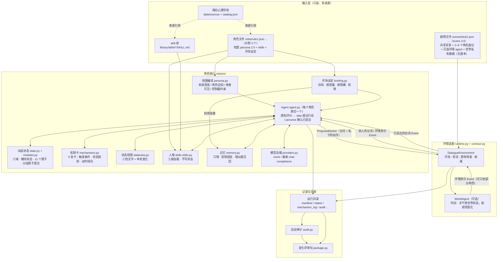
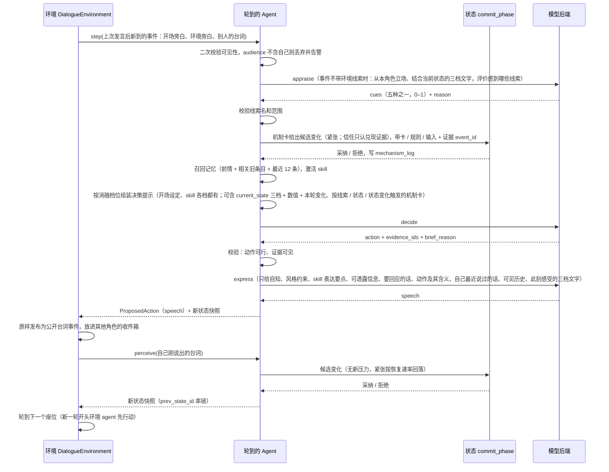
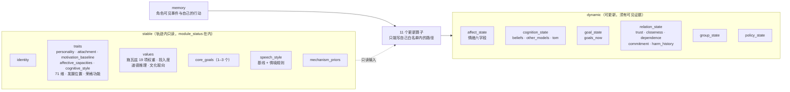
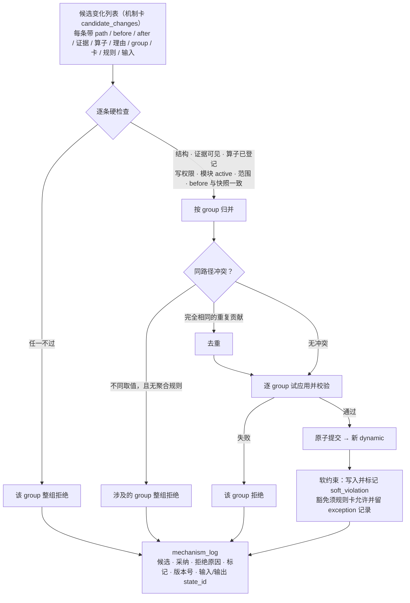
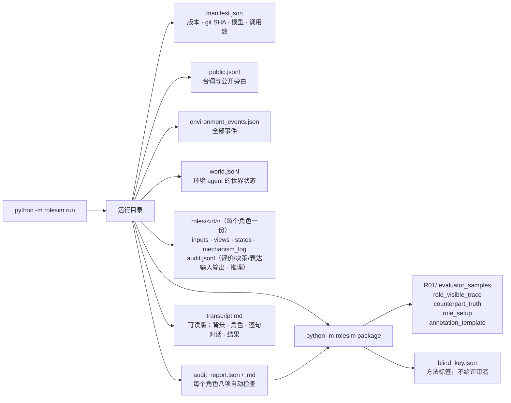

# 当前架构与实现总结

本文档描述 2026-10-20 时仓库里**已经实现**的东西：分几层、数据怎么流、哪些地方做了隔离和校验、哪些还是空的。一次运行的调用链与参数传递见 [06-runtime-flow.md](06-runtime-flow.md)，模块划分与各模块的权责见 [08-modules.md](08-modules.md)；实现计划与进度见 [../plan/](../plan/README.md)；设计动机见 [01-design.md](01-design.md)，skills 调研见 [10-persona-skills-survey.md](10-persona-skills-survey.md)。

## 1. 一句话概括

把心理学组整理的两份库和回复，落成一条**可审计的数据通道**：2–6 个角色文件（稳定档案 + skills + 开场设定）+ 剧情文件（共享背景 + 角色座位 + 可选的环境 agent）→ 角色按座位轮流发言，环境转发台词、按规则改变世界 → 每个角色对收到的事件做感知评价 → 机制卡产生带证据的状态更新 → 状态以三档文字进入评价、决策与表达 → 全程落盘 → 自动审计 → 盲化评审包。

通道已经打通，并有 173 项工程测试。2026-10-20 新增人格 skills、角色开场设定（交互目标、想透露 / 想隐瞒、前情提要）和记忆召回；输入整理成"一个角色一个文件、一个剧情一个文件"；随后去掉事件脚本，改为两个角色基于背景自主对话，并用本地 Qwen3-8B（思考模式）跑通；当晚按 [plan/02](../plan/02-multi-agent-and-state-mechanism.md) 把状态更新并入机制卡、让状态进入三处提示，并支持 2–6 个角色和规则驱动的环境 agent。均不改动与两组约定的合同。**心理内容大多仍是空壳**：11 个更新算子只有写权限、没有幅度规则；机制卡数值是未校准的工程假设。所有验证都是工程层面的，没有心理有效性证据，mock 的输出差异也不能当证据。

## 2. 总体结构

读图要点：

- **环境不写剧本、不编造结果。** 它只开场、按座位轮流请角色发言、把台词原样转给所有在场角色，到轮数上限或有人选 `close` 时收尾。角色选的动作留在 `intent_note` 里，不进任何事件。
- **环境 agent 不是人。** 场景可以带一个规则驱动的环境 agent：它持有世界状态（时间、天气、地点、环境声音），第 2 轮起每轮开头按规则推进时间、改变世界，并用旁白告诉角色；规则可以指定只让部分角色知道（私有可见性），也可以标注线索。它没有心理状态，不替角色说话、不裁定角色动作的结果、不写角色状态。
- **每个角色是独立的 Agent。** 各有各的状态链、记忆和模型调用；别人的开场设定、状态、推理永远不进入自己的提示。
- **只有 Agent 通过后端接触模型。** 状态、机制、画像编译都能在没有模型的情况下完整校验。
- 虚线表示只是来源引用：`catalog.json` 提供章节索引和哈希，档案里的 `source_ref` 必须指向其中的条目（有测试检查）。

## 3. 分层与代码地图

| 层 | 文件 | 职责 | 状态 |
|---|---|---|---|
| 来源 | `catalog.py`、`data/` | 两份库的快照、章节索引（196 条）、哈希；其中的指令性文字没有执行权限 | 完成 |
| 画像 | `persona.py` | schema 2.0 校验、四种视图编译、条件化行为语句 | 结构完成，仅 P1 |
| 模块状态 | `modules.py` | 六种状态、状态与值一致性检查、转换审计；稳定与动态共用 | 完成 |
| 动态状态 | `state.py` | 六个状态域、11 个算子写权限、`commit_phase`、三级错误、四类版本号 | 结构完成，规则很少 |
| 机制 | `mechanisms.py` | 5 张机制卡（card schema 2.0）：触发条件读线索 / 状态 / 状态变化；`effects` 指向状态规则（`tension_v1`、`trust_v1`，参数在卡上）；动作倾向打分取前 3 | 只有 2 张卡有状态规则；数值未校准 |
| 状态视图 | `stateview.py` | 状态换成三档文字（取值范围三等分）+ 自上次发言以来的净变化；决策另带数值与算子名 | 切分是工程假设 |
| 人格 skills | `skills.py`、`library/skills/` | SKILL.md 解析校验（兼容 Agent Skills 规范）、人物绑定、按线索 / 开场设定激活取前 3、表达要点分发 | 9 个 skill，内容待审定 |
| 开场设定 | `briefing.py` | 角色文件 `setup` 的校验；决策视图 / 表达视图分开；泄露关键词检测 | 完成 |
| 记忆 | `memory.py` | 只增；前情固定在前；较早条目按字符二元组相似度 + 显著性召回；最近 12 条完整保留 | 完成，未接 Mem0 服务 |
| 接口合同 | `contract.py` | Event / ProposedAction / AgentState / StateDelta 数据类与校验 | 完成（按环境组合同 v0） |
| 接口定义 v1 | `agent_api.py` | 运行器 ⇄ 角色 / 环境的 `act` / `perceive` 数据类型、双方校验、记录拆分与分发、name 路由（`Directory`） | 完成（[plan/07](../plan/07-agent-adapter-integration.md)） |
| 角色适配器 | `adapter.py` + `cognition.py` | 把 `Agent` 放到 `act` / `perceive` 后面；name 路由、记录转事件、请求幂等、认知投影 | 完成；只出台词，无思考与外显行动 |
| 本地参考运行器 | `loop.py` | 按接口定义 v1 第 3 节跑一场；环境用 `EchoEnvironment` 替身 | 完成；不生成审计报告 |
| 角色 | `agent.py` | `step` / `perceive`、可见性二次校验、决策与表达编排、状态链 | 完成 |
| 后端 | `providers.py` | mock 夹具；兼容 `/chat/completions` 的真实后端（评价、决策、表达三类调用；思考模式开启，推理只进运行记录），失败不回退 | 完成，已接本地 Qwen3-8B |
| 词表 | `vocab.py` | 七个交流动作、五种线索及其中文说明 | 完成 |
| 环境与运行 | `runtime.py` | scene schema 3.0 校验、`WorldAgent`、`DialogueEnvironment`、`run_dialogue`、按角色落盘、git SHA | 2–6 个角色，固定轮转；规则驱动的环境 agent |
| 审计 | `audit.py` | 从落盘产物按角色重新推导八项自动检查（含状态变化归因） | 完成 |
| 可读记录 | `readable.py` | 运行结束后自动把运行目录整理成 `transcript.md`（背景、角色、逐句对话、结果）；只读落盘文件，不重新计算 | 完成 |
| 评审包 | `package.py` | 盲化评审包导出 | 完成 |
| 角色与剧情文件 | `roles.py`、`roles/`、`scenes/` | 角色文件与剧情文件的读取校验、`fit` / `fit_cast` 入座检查、`seat` 为每个角色座位组装 Agent、`run` | 完成 |
| 入口 | `__main__.py` | `catalog` `list` `validate` `compile` `skills` `run` `audit` `package` `readable` | 完成 |
| 示例与重建 | `roles/`、`scenes/`、`scripts/bootstrap_examples.py` | 三个虚构角色 role1（林澄，项目组一方）、role2（周越，合作方一方）、role3（王岚，项目负责人）+ 三个剧情 test1（交付沟通）、test2（剩余数据跟进），各最多 8 次发言；test3（三方会议 + 会议室环境 agent），最多 12 次发言 | 虚构设定 |

## 4. 一轮发言怎么被处理

要点：

- 每个事件**用同一份已提交快照**生成候选，同一阶段内不读取未提交的候选。
- 决策或表达失败时返回 `status=error`，**状态不前进**，也不会换成 mock 或把内心独白当台词。
- `perceive` 之后下一次 `step` 读取的就是最新状态；`prev_state_id` 不匹配会被拒绝。
- 自己的台词在 `perceive` 时才进入记忆（环境确认"已说出"），记忆里自己的话标为"我"，别人的话标为其座位名。
- 感知评价提示在 `profile_state` 及以上会带状态的三档文字（同一句话，紧张时与放松时可能评价不同）；`profile_only` 与 `--appraise-state off` 时不带。因此三档消融的状态轨迹不再保证相同；需要"评价相同"的对照时用 `--appraise-state off`。

## 5. 状态结构

模块状态是贯穿两侧的一套规则：

| 状态 | 含义 | 值的要求 |
|---|---|---|
| `active` | 已启用且有值 | 必须有值，且稳定模块要有来源 |
| `unknown` | 已启用但证据不足 | 必须是 `null`，不能写成 0 或中性值 |
| `not_modeled` / `disabled` | 本版未建模 / 被关闭 | 不得持值，不参与计算 |
| `inactive` / `not_applicable` | 本轮未激活 / 场景不适用 | 不得持值 |

只有 `active` 模块可以被写入。状态转换写入审计记录；重新启用需要完成校验。

目前 `dynamic` 里实际有更新规则的只有两条，都挂在机制卡上：紧张（`affect_state.emotion.intensity`，`appraise` 卡的 `tension_v1`）和对每个其他角色的信任（`relation_state.<角色 id>.trust`，`trust` 卡的 `trust_v1`）。关系状态按其他角色各存一份。

## 6. 候选变化如何提交

- 一个 group 内的变化要么全部生效要么全部不生效；其他 group 不受影响。
- 同一个 `commit_key`（角色/事件/阶段）重试是空操作。
- 硬错**不能被豁免**；目前唯一的软规则（信任单步上限）也不允许豁免，因为还没有规则卡允许。

## 7. 谁能看到什么

| 信息 | 决策提示 | 表达提示 | 评审包·评测版 | 评审包·角色可见版 |
|---|---|---|---|---|
| 自我理解 `self_view` | 是 | 是 | 否 | 否 |
| 条件化行为语句（含表达风格规则） | 是 | 仅 `speech_style.*` 部分 | 否 | 否 |
| 动机基线、价值、核心目标 | 是 | 否 | 否 | 否 |
| 可见历史（含别人的台词、发给自己的环境旁白） | 是 | 是 | 是 | 是（作为轨迹） |
| 别人的开场设定、状态、推理 | 否 | 否 | 仅在单独的对照文件 | 否 |
| 当前动态状态 | 仅 `profile_state` 及以上：三档 + 数值 + 本轮变化与算子名（评价提示只有三档） | 仅 `profile_state` 及以上：三档 + 变化方向，无数值、无算子名 | 是（前后状态） | 否 |
| 只发给别人的环境旁白 | 否 | 否 | 仅在单独的对照文件 | 否 |
| 机制卡与控制器提示 | 仅 `profile_state_mechanisms` | 否 | 否（提示不导出，避免暴露档位） | 否 |
| 模型输出与推理摘要 | — | — | 是 | 否 |
| 世界私有数据、角色不可见事件 | 否 | 否 | 仅在单独的对照文件 | 否 |
| 开场设定：交互目标、想让对方知道的信息 | 是 | 是 | 是（`role_setup.json`） | 否 |
| 开场设定：不想让对方知道的信息 | 是（`keep_private`） | **否** | 是（`role_setup.json`） | 否 |
| 前情提要 | 是（记忆首条，可作证据） | 是 | 是（`role_setup.json`） | 否 |
| skill 名称与描述、决策要点、反模式 | 是 | 否 | 否（只列已绑定 skill 名，不写是否启用） | 否 |
| skill 表达要点 | 否 | 是（仅已激活的） | 否 | 否 |

**已知缺口：评测版样本目前不带稳定画像**（自我理解、特质、价值、目标）。评"稳定一致性""角色可区分性"需要它，导出时要补，补的时候仍须与方法标签分开。

三档消融入口：`profile_only`（相同历史，三处提示都不注入状态与机制）、`profile_state`（评价、决策、表达都加状态视图）、`profile_state_mechanisms`（决策再加机制卡，默认）。**状态在三档下都计算并记录**；`--appraise-state off` 让评价提示在任何档位都不带状态，作为对照。skill 属于人物画像，三档都注入；另有独立开关 `--no-skills`，保留绑定记录但不注入，用于 skill 的对照。

## 8. 运行产物与评审链路

- **自动审计**从落盘文件重新推导，不信任引擎自己的记录：字段有效性、证据与可见性、写权限、stable 一致、轨迹可追溯、隐瞒信息未泄露（隐瞒原文不进表达提示，关键词不出现在台词）、跨角色隔离（任何其他角色的隐瞒原文和世界私有数据不出现在本角色的任何调用里）、状态变化归因（每条变化的机制卡、规则路径与算子相符，输入与档案和本角色感知的线索一致，按规则复算等于记录值；决策提示里所示机制卡的触发条件能从记录复核）；另外单列软约束、豁免、被拒依赖组、模块覆盖、主动透露次数。其余维度只标注"需人工评分"。
- **评审包**里每个运行的每个角色是一个盲化单元；模式、后端、模型、代码版本只在 `blind_key.json`。其他角色的开场设定和末态单独成文件，只供对照。
- 每次运行自带四类版本号：`construct_definition_version`（未登记）、`state_schema_version`、`update_rule_version`、`evaluation_protocol_version`（未冻结）。

## 9. 核心不变量

这些由代码或测试强制，而不是约定：

1. `stable` 在一个轨迹内不可变；`StateDelta` 的路径以 `stable` 开头一律拒绝，运行中每轮还用哈希复核。
2. 每条状态变化必须带**本角色可见**的证据，且只能写 `active` 模块、自己算子白名单内的路径。
3. 数值越界直接拒绝，不截断；未知用 `null`，不用中性值代替。
4. 世界私有数据和他人的隐藏心理字段（包括别人的开场设定和状态）不进入任何模型调用；角色不可见的事件在入口被丢弃。角色自己要隐瞒的信息只进评价和决策提示，不进表达提示。
5. skill 只影响提示内容，不产生状态变化；记忆只增不改。
6. 他人的口头承诺不算"已兑现"的证据，只有叙述事实和环境裁决的结果可以改变可靠性判断；所以纯对话里信任不变。
7. 环境（包括环境 agent）不替角色说话、不编造结果、不写角色状态；模型给出的感知线索只能是登记过的五种、0–1，状态变化由机制卡的规则计算，每条都能被审计复算。
8. 模型调用失败就停下并记录，**不静默回退 mock**。
9. 旧 schema 的档案和轨迹被拒绝，不做静默转换（剧情只接受 scene schema 3.0，2.0 与带事件脚本的 1.x 格式被拒绝）。

## 10. 完成度与未做

下表只列"现在有什么、没有什么"；做过的阶段、下一步和等谁交付见 [../plan/README.md](../plan/README.md)。

| 方面 | 已有 | 没有 |
|---|---|---|
| 画像 | schema 2.0，20 个稳定模块带状态，P1 30 分面，施瓦兹 19 项，核心目标 | P2/P3 及三方案比较；分面级 unknown；其余 26 个分面的行为投影；71 维；stable 变更的版本迁移结构 |
| 人格 skills | 9 个 SKILL.md、人物绑定、三级加载、`--no-skills` 对照 | 心理学组审定内容；从语料蒸馏 skill；纠正层与 skill 版本；由模型读描述自主激活的档位 |
| 开场设定与记忆 | 角色文件的开场设定（目标、透露、隐瞒、前情）；只增记忆与召回；隐瞒泄露审计 | 接入 Mem0 服务；换说法的泄露检测；记忆更新人格（需与心理学组对齐） |
| 动态状态 | 六域骨架，原子提交，三级错误，日志与版本；状态规则挂在机制卡上，三档文字进入三处提示 | 心理学组审定的规则卡与三档切分；其余 3 张卡的状态规则；11 个算子的机制卡数值；信念、目标、他人模型的更新规则；时间事件与衰减规则 |
| 环境 | 2–6 个角色基于背景按座位轮流自主对话；规则驱动的环境 agent（时间、天气等，私有旁白）；合同 v0 已与环境组对接 | 自由抢话 / 动态发言顺序；由模型驱动的环境 agent；群体状态 `group_state` 的规则；非对话行动与世界事实（如"文件已到"）；时间轴与打断（设计见 [plan/03](../plan/03-timeline-and-interruption.md)） |
| 模型 | 评价 / 决策 / 表达三类调用、严格 JSON、思考模式、本机回环不走代理；本地 Qwen3-8B 已跑通 | 更大模型；多次重复运行的统计 |
| 评测 | 三档消融，自动审计，盲化评审包，标注模板 | 评审包带稳定画像；评测协议冻结；标注工具；复标统计；回放工具；真人基线 |

## 11. 常用命令

命令、参数、后端配置和运行产物说明见 [03-usage.md](03-usage.md)；一次运行的调用链见 [06-runtime-flow.md](06-runtime-flow.md)。

## 12. 证据边界

AGENTS.md 要求明确区分来源理论、工程假设、作者报告结果、本地工程检查、模型实验和人工验证。当前仓库里的结论**只到"本地工程检查"这一层**：结构、证据、隔离和可复现性可以被测试和审计验证，"角色像不像人"没有被验证，也不能由 mock 或审计通过来推出。
