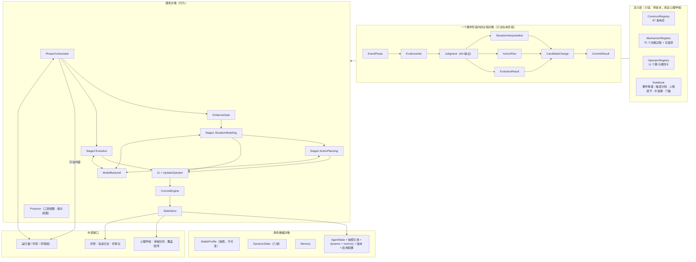
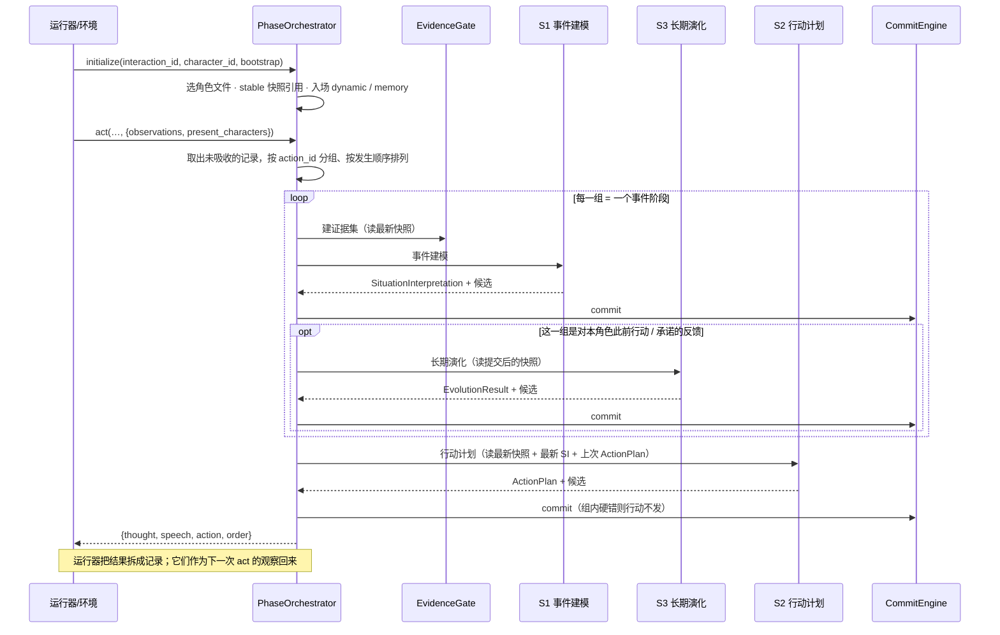

# 框架重审：面向对象的字段与接口设计（草案）

2026-11-07 起草。依据心理学组交付的 v1 材料（[data/sources/psychology_v1/](../data/sources/psychology_v1/README.md)：构念登记、角色状态说明、状态变化规则、三个心理流程 skill），把整个框架按"对象—字段—接口"重新梳理一遍。

- **这是目标设计，不是现状。** 现状见 [docs/07-architecture.md](../docs/07-architecture.md)。本文落地后，行为说明要同步进 `docs/`。
- **对外接口已按环境组 2026-11-07 的接口说明对齐**（[原文](../data/sources/contracts/Agent接口说明_环境组_2026-11-07.md)，本仓库称接口 v2）：第 7.3、8.1 节是对齐后的版本；外部接口层代码（`agent_api.py` / `adapter.py` / `loop.py`）已经按 v2 改完，内部的三阶段与状态重建还没开始。
- **逐字段的规格**（每个构念、过程对象、日志、接口的字段与维护方）单独写在 [09](09-interface-and-field-spec.md)；本文管对象划分与流程，两者冲突时字段以 09 为准。
- 证据层级：本文是**工程设计**；引用的数值（幅度分档、半衰期、门槛）是心理学组标注的"本版本初始值"，不是经过验证的规律。

---

## 1. 目标与必须守住的约束

**目标。** 一个由心理学构念约束的虚构角色：在环境里看到别人的言行 → 形成带不确定性的情境解释 → 在多目标、多约束下选择行动 → 根据反馈把经历沉淀为跨事件的持久变化。每一步都能回放、能追溯到角色可见的证据。

心理学 v1 材料把这个目标落成了一组硬约束，框架的每个对象都要服务于它们：

| # | 约束 | 出处 |
|---|---|---|
| C1 | stable 在轨迹内只读；长期变化只能以**修订候选**提出，审核后生成新 stable 快照 | 状态说明 §4、§10；变化规则 §10 |
| C2 | 决策过程（dm）只产中间判断，**没有写权限**；只有 11 个更新算子能写 dynamic / memory，且每个算子有构念白名单 | 变化规则 §2、§5、§12 |
| C3 | 每条写回必须引用**本角色可见**的事件；证据分亲见 / 听说 / 推断，证据质量限制幅度档 | 变化规则 §3.1、§5.0 |
| C4 | 同一角色、同一事件阶段的所有过程读**同一份已提交快照**；不得读未提交候选 | 变化规则 §3.2 |
| C5 | 事实、解释、预测、意图、承诺、结果分开记录；后来的结果**不能回头改写**早先阶段 | 三个 skill §6 回放一致性 |
| C6 | unknown 与 0 / 中性值不同；关闭 / 未建模的模块不得用默认值冒充 | 登记 §3.2；状态说明 §3.2 |
| C7 | 三层可见性：系统真值 / 角色自知 / 他者可见；他人隐状态、系统真值不进角色输入 | 状态说明 §7 |
| C8 | 幅度由程序给合法区间，模型只在区间内选值并给理由；越界拒绝不截断 | 变化规则 §5.0、§7、§8 |

---

## 2. 现状与 v1 材料的差距

| 方面 | 现状（代码） | v1 要求 | 差距 |
|---|---|---|---|
| 构念命名 | 路径式 `dynamic.cognition_state.beliefs` | `construct_id`：`s.` / `d.` / `m.` / `dm.` 前缀 | 需要一张 construct_id ⇄ 存储路径的对照，**以 construct_id 为主键** |
| stable | persona schema 2.0，20 个模块，仅 P1，`mechanism_priors` | 42 条构念；P1/P2/P3 三选一；自我系统、人格功能、27 子项决策偏好、71 维；每模块 10 项元数据 | 模块不全；`mechanism_priors` 要换成 `decision_preferences`；元数据不全 |
| dynamic | 六域骨架，实际只有"紧张"和"信任"两条规则 | 42 条构念，每条带 6 项元数据 | 大部分构念没有存储结构，更没有规则 |
| memory | 只增文本条目 + 相似度召回 | 条目 + 可及性 + 再激活记录，获得途径四类 | 缺可及性与再激活 |
| 机制 | 5 张机制卡，靠 5 种线索打分选卡 | 75 个决策过程，每个有登记的可选项；稳定偏好给主导 / 备用项 | 机制层要重建；5 种线索只是 skill 1 评价结果的极简替身 |
| 更新算子 | 11 个名字 + 路径白名单 | 11 张规则卡：触发、读写、幅度、调节、半衰期、证据 | 白名单要按构念重写，规则卡要实现 |
| 流程 | 评价 → 机制卡 → 决策 → 表达；没有反馈后的学习 | 三阶段：事件建模 → 行动计划 → 长期演化；阶段之间提交 | 缺"长期演化"阶段；评价和决策的产物太薄 |
| 时间 | 无时间轴；紧张按轮回落 | 时间推进事件 + 半衰期 | 依赖环境组 |
| 场景结构 | 共享背景文本 | 规范、群体、制度权力、可见性表、参考事件等级 | 依赖环境组 |

结论：**现有的骨架（原子提交、三级错误、可见性校验、四类版本号、接口适配层）可以保留**；画像、状态、机制和流程四块要按 v1 重建。

---

## 3. 总体对象模型



四类对象各自的职责：

| 类别 | 回答 | 生命周期 | 谁能改 |
|---|---|---|---|
| 定义层 | 构念是什么、怎样取值、谁能写、写多少 | 按版本冻结 | 只有心理学组发新版本 |
| 角色数据 | 这个角色此刻是谁、处于什么状态、记得什么 | stable 跨轨迹；dynamic / memory 随阶段提交 | stable：快照迁移；dynamic / memory：只有算子经 CommitEngine |
| 过程对象 | 这一阶段看到了什么、怎么理解、打算怎么做、想改什么 | 一个事件阶段；结束后进日志，不再修改 | 产生它的阶段；之后只读 |
| 服务对象 | 怎样把上面这些串起来 | 进程内 | 工程侧 |

---

## 4. 定义层对象

这些对象把心理学组的 md 文件变成程序可查的表。**原文件不改**；另建一份机器可读的登记（建议 `data/registry/psy_v1.json`），由脚本从原文抽取、人工核对，带原文行号和哈希，和现在的 `catalog.json` 同一做法。

```python
@dataclass(frozen=True)
class Construct:                 # 一条构念（登记表 §4–§6）
    construct_id: str            # "d.relation.trust"
    layer: Literal["s", "d", "m"]
    module: str                  # "relation_state"
    name_zh: str
    value_form: str              # "z_-2_2" | "unit_0_1" | "valence_-1_1" | "ordinal:..." | "category:..." | "record" | "text"
    tempo: Literal["slow", "fast", "category", "none"]    # 决定幅度分档（变化规则 §5.0）
    self_visibility: Literal["aware", "partial", "unaware"]
    other_visibility: Literal["observable", "presented", "hidden"]
    high_impact: bool            # 非档案明写时需审核（状态说明 §8.3）
    primary: bool                # 派生字段为 False，并给出 derived_from
    writer: str | None           # 唯一主写入算子；stable 为 None
    half_life: str | None        # 第九部分；None = 不随时间冲淡
    source_ref: str              # 原文位置

@dataclass(frozen=True)
class DecisionMechanism:         # 一个决策过程（登记表 §7）
    dm_id: str                   # "dm.cog.attribution_responsibility"
    chapter: int                 # 1–10
    options: tuple[str, ...]     # 登记的可选项；策略取值只能来自这里
    reads: tuple[str, ...]       # 读取的 construct_id
    hands_to: tuple[str, ...]    # 结果交给哪些算子（变化规则 §4）
    stages: tuple[int, ...]      # 在哪个阶段被调用（1/2/3）
    card: dict | None            # 高影响过程的机制卡（变化规则 §4.1）

@dataclass(frozen=True)
class UpdateOperator:            # 一张算子规则卡（变化规则 §5）
    name: str                    # 11 个之一
    writes: frozenset[str]       # 构念白名单
    triggers: tuple[str, ...]
    reads: tuple[str, ...]
    property_affected: tuple[str, ...]   # 敏感度 / 峰值 / 持续 / 恢复
    commit_group: str            # "affect_self_relation_group" | "goal_commitment_strategy" | "memory" | "decay"
    evidence_rule: str
    soft_rules: tuple[str, ...]

class RuleBook:                  # 变化规则 §3.6、§5.0、§7、§9、§10
    event_grades: dict[int, str]                  # 1 日常 · 2 一般 · 3 显著 · 4 重大
    bands: dict[str, dict[int, tuple[float, float]]]   # tempo → 等级 → 区间
    major_extension: dict[str, tuple[float, float]]
    evidence_cap: dict[str, int]                  # 听说最多中档(3)，推断最多小档(2)
    personality_modulation: ...                   # 敏感度换档、峰值定位、半衰期 × 1.3^z、合并规则
    half_lives: dict[str, str]
    revision_thresholds: dict[str, ...]
```

`VersionSet` 记录四类版本号：`construct_definition_version`（= 登记表版本 `psy-v1`）、`state_schema_version`、`update_rule_version`、`evaluation_protocol_version`。每个 AgentState、每条日志都带。

---

## 5. 角色数据对象与字段清单（心理学部分）

### 5.1 通用包装

每个值都包在带元数据的壳里，这是 C3、C6 能被程序检查的前提。

```python
Status = Literal["active", "unknown", "inactive", "disabled", "not_modeled", "not_applicable"]
SourceKind = Literal["explicit", "inferred", "model_inferred", "default"]

@dataclass
class StableModule(Generic[T]):          # 状态说明 §3.3：stable 每模块 10 项元数据
    value: T | None                      # status != active 时必须为 None
    status: Status
    construct_refs: list[str]
    source_refs: list[str]               # 档案原文位置；model_inferred 必须留原文
    source_kind: SourceKind              # 模块内个别子项来源不同时在子项上单独标
    confidence: float | None
    visibility: Visibility               # 自知档 + 他者档
    derived_from: list[str]
    version: str
    disabled_reason: str | None
    needs_review: bool

@dataclass
class DynamicField(Generic[T]):          # 状态说明 §3.3：dynamic 每字段 6 项元数据
    value: T | None
    status: Status
    source: str                          # 入场：档案 / 场景；运行中：支持变化的 event_id
    confidence: float | None
    visibility: Visibility
    last_updated_event: str | None
    version: int
```

### 5.2 StableProfile（42 条，轨迹内只读）

`StableProfile` 是一个**不可变快照**，带 `snapshot_id`、`previous_snapshot_id`、`assembly_order`。字段按登记表分组；"读取环节"指三个阶段里谁主要用它。

| 分组 | 构念（construct_id 省略 `s.` 前缀） | 保存形式要点 | 主要读取环节 |
|---|---|---|---|
| **identity** | `identity.demographics` 人口学 | 姓名必填，其余可 unknown；健康条件写功能影响 | 能力范围、可见性 |
| | `identity.social_roles` 社会角色与制度位置 | 每个角色：类别、义务、权利、显著性、认同度；制度权力 / 公共声望 / 专业权威分开 | S2 硬约束（权限）、S1 规范判断 |
| | `identity.resources` 资源与外貌 | 每项分真实值 / 主动呈现值 / 他者可见值 | S2 硬约束（资源）、他者可见层 |
| | `identity.life_history` 生命历程 | 事件—阶段—持续影响—当前意义；入场记忆来源 | 记忆初始化 |
| **人格（三选一）** | `traits.personality.p1_big_five` / `p2_16pf` / `p3_jung_hexaco` | P1：30 分面（-2—+2），领域分不派生；P2：16 初级因素，5 全局因素等权派生；P3：荣格八功能权重 + HEXACO 分面 | 幅度调节（敏感度、峰值、恢复）、表达倾向 |
| **依恋** | `traits.attachment.global` | 焦虑、回避两轴 -2—+2；近中点不派生类型 | S1 关系威胁敏感度、S3 修复 |
| **动力基线** | `traits.motivation.source_activation` / `need_vector` / `goal_computation` / `conflict_regulation` / `self_efficacy` | 0—1；需要向量每项三值（重要性、最低可接受、匮乏敏感度）；自我效能按领域 | S1 威胁/奖赏权重、S2 期望—价值—成本 |
| **情感能力** | `traits.affect.emotion_baseline` / `appraisal_bias` / `regulation_capacity` / `empathy` / `emotional_intelligence` / `expression` | 情绪基线按 8 个情绪家族存激活阈值 | emotion_update 的敏感度与回落目标 |
| **社会心智** | `traits.social_cognition_71d` | 71 个三级条目五档；未赋值取 0 标 default；二、一级派生 | ToM 上限（1.1.4、1.5.2 映射）、S2 执行上限 |
| **认知风格** | `traits.cognitive.dual_process` / `need_for_cognition` / `need_for_closure`（紧迫性、固着性分存）/ `ambiguity_tolerance` / `flexibility` / `metacognitive_calibration`（按领域） | -2—+2 | S1 保留几个假设、多快定论；belief_revision 敏感度 |
| **发展与自我** | `traits.development.position` | 4 个字段：stage（16 个有序类别，不做算术）、transition、domain_profile、evidence | 他人模型质量、解释的复杂度 |
| | `traits.self.self_concept` / `self_esteem` / `self_discrepancy` / `identity_status` / `role_identity` / `social_identity` | 自尊存水平 + 稳定性；角色认同对应 social_roles；社会认同按群体 | self_state_update 敏感度、group_state 基线 |
| **人格功能** | `traits.function.domains`（5 域 × 基线 / 压力下最差 / 恢复时间 / 支持条件，0—4）/ `pathology_traits`（7 项）/ `organization_label`（派生） | 压力下最差不得低于基线 | 防御层级上限、现实检验（解释偏离证据的上限） |
| **决策偏好** | `traits.decision_preferences` | 27 子项，每项 = 主导项 + 备用项（+ 阈值、参数），取值只来自对应 dm 的可选项；风险分三情境；SVO 四取向权重；公平五规则排序；重复博弈 6 参数 | 首次调用某 dm 时的当前策略 / 备用策略 |
| **价值** | `values.schwartz_priorities` | 19 项全在；每项：权重（和为 1）、冲突阈值、可让步范围；+ 总投入度 | S2 冲突裁决、底线 |
| | `values.moral_reasoning` / `values.cultural_orientation` | 阶段需附理由证据；文化 6 项可按领域分存 | S1 规范违背等级、S2 理由组织 |
| **核心目标** | `core_goals.primary` | 1—3 个；每个：goal_id、定义、priority_baseline、stability、identity_links、goal_version、方向、SDT 类型、上位目标、冲突关系 | S1 目标相关性、S2 决策框架、S3 修订门槛 |
| **表达** | `speech_style.baseline` | 表达基线 + 改变表达的情境 | 表达（S2 末步） |

另有 `EnableConfig`（状态说明 §9）：每个 stable 模块、dynamic 字段、决策过程是 启用 / 关闭 / 未建模，非启用项写原因；轨迹内不变。

### 5.3 DynamicState（42 条，六域都必须出现）

"写入算子"是登记的唯一主写入者（变化规则 §12），"写入阶段"取自三个 skill 文件的 §4.2。

| 域 | 构念（省略 `d.` 前缀） | 保存形式 | 写入算子 | 写入阶段 | 回落 |
|---|---|---|---|---|---|
| **affect** | `affect.emotion` | label、valence(-1—1)、arousal、intensity、duration_hint、confidence；dominance 默认 not_modeled | emotion_update | S1；S2 仅情绪调节结果 | 按情绪家族 1 小时—2 天 |
| | `affect.stress` | 0—1 | emotion_update | S1 | 威胁解除后 12 小时 |
| | `affect.threat_reward_activation` | BAS / BIS / FFFS 各 0—1 | emotion_update | S1 | 同上 |
| | `affect.regulation_state` | 逐条调节；无则 inactive | emotion_update | S1、S2 | 结束即 inactive |
| **cognition** | `cognition.belief` | belief_id、命题、对象、情境与时间、来源、confidence（未判断为 unknown）、冲突组及本轮采纳项；事实命题与解释命题分开 | belief_revision | S1、S3 | **不冲淡** |
| | `cognition.attention` | 焦点（对象、持续度）、忽略项（信息、持续度、是否被提醒） | belief_revision | S1 | 焦点 1 天 |
| | `cognition.attribution` | 按事件 × 对象：位置、稳定、全局、可控、意图、责任类型与程度、确信度；未定的轴留空 | belief_revision | S1 | 不冲淡 |
| | `cognition.self_evaluation` | 总体 + 领域，-2—+2，偏离自尊基线 ≤1.0 | self_state_update | S1 条件、S2 条件、S3 | 3 天回自尊基线 |
| | `cognition.task_self_efficacy` | 按任务 | self_state_update | 同上 | 任务结束即清 |
| | `cognition.shame` | 0—1 | self_state_update | 同上 | 7 天 |
| | `cognition.face_cost` | 受损程度、维护需要、在场观众 | self_state_update | 同上 | 3 天；同批观众在场时暂停 |
| | `cognition.self_responsibility` | 按事件：程度、类型 | self_state_update | 同上 | — |
| | `cognition.other_model` | 按对象：推断内容、ToM 阶数、确信度、支持事件；**永不写对象真值** | other_model_update | S1 | 不冲淡 |
| | `cognition.tom_level` | 上限（轨迹内不变）、当前可用、对象特定、允许任务；降级须记触发条件，最多降 1 阶 | other_model_update | S1 | 条件解除回上限 |
| **goal** | `goal.goals_now` | 内容、优先级、阶段（进行/完成/受阻/降级/暂停/放弃）、对应核心目标、来源类型、理由；完成的不删 | goal_update | S2、S3 | 不冲淡 |
| | `goal.value_activation` | 按 19 项价值 | goal_update | S2、S3 | 目标了结后 1 天 |
| | `goal.goal_activation` | 按核心目标 | goal_update | S2、S3 | 同上 |
| | `goal.goal_commitment` / `feasibility_estimate` / `threat_to_goal` | 按核心或当前目标；可行性未评估为 unknown | goal_update | S2、S3 | — |
| | `goal.goal_conflict` | 涉入目标/价值、顺序、底线、补偿、处理结果 | goal_update | S2 | 不冲淡 |
| | `goal.action_orientation` | 推进方向、短期优先目标、指向对象 | goal_update | S2 | — |
| | `goal.revision_candidate` | 对某核心目标的修订提议、证据事件、独立证据数、窗口起点、自我承诺、审核状态 | goal_update | S3 | 不冲淡 |
| **relation**（按对象 role_id 有向） | `relation.trust` / `closeness` / `dependence` / `commitment` | 各 0—1，互相独立；trust 内部再分能力、善意、诚信、可靠性的证据 | relation_update | **仅 S3** | **不冲淡** |
| | `relation.harm_history` | 事件、描述、严重度（四级）、承认、修复程度、最近激活、显著性；只追加 | relation_update | S3 | 显著性 10/30 天，下限 20% |
| | `relation.power_asymmetry` | 客观（场景给，4 个基础 × 是否知晓）+ 主观（方向、基础、确信度）；relation_update 只写主观 | relation_update | S3 | — |
| **group** | `group.membership` / `identity_salience` / `norm_salience` / `alliance` / `boundary` / `responsibility_allocation` | 群体、规范的编号来自场景 | group_state_update | S1 条件、S2 条件、S3 | 显著性 1—3 天；其余不冲淡 |
| **policy** | `policy.action_commitment` | 内容、对象、形成事件、期限、阶段（形成/维持/兑现/违约/暂停/撤销）、是否公开、手段；结束不删 | commitment_update | S2（本人决定）、S3（认定兑现/违约） | 不冲淡 |
| | `policy.current_strategy` / `fallback_strategy` / `switch_condition` | 按"dm × 对象或情境"；取值 = 该 dm 的可选项；切换条件写成可观察信号 | strategy_learning | S2 | — |
| | `policy.strategy_weight` / `learning_state` | 按 dm 的选项权重；近期反馈、探索度、累计 | strategy_learning | **仅 S3** | 短期偏离 7 天 |
| | `policy.mechanism_preference_state` | 暂时偏向、强度、起因事件、范围 | strategy_learning | S3 | 情境结束后 1 天 |

### 5.4 Memory（3 条）

```python
@dataclass
class MemoryEntry:               # m.entry
    entry_id: str
    summary: str                 # 只含本角色当时可见的内容
    source_events: list[str]
    time: SceneTime
    involved: list[str]          # role_id
    channel: Literal["witnessed", "hearsay", "inferred", "pre_entry"]
    importance: float
    emotional_tone: float
    accessibility: float         # m.accessibility；半衰期 7 天，每被调取一次加倍
    reactivations: list[Reactivation]   # m.reactivation：事件 + 线索
    interpretations: list[Interpretation]  # 后来的重新解释另存，不覆盖原条目
```

条目只追加，不删除；`decay_or_recovery` 只降可及性。

### 5.5 AgentState 容器

```python
@dataclass(frozen=True)
class AgentState:
    state_id: str
    prev_state_id: str | None
    role_key: RoleKey            # = interaction_id + character_id；character_id 是角色库 ID，跨互动不变（§8.1）
    stable_snapshot_id: str      # 指向 StableProfile，不内嵌可写副本
    dynamic: DynamicState
    memory: Memory
    versions: VersionSet
    enable_config_id: str
```

`thought` 和 `mechanism_log` **不放在 AgentState 里**，作为轨迹日志另存（状态说明 §2）。

### 5.6 三层视图（Projector 的产物）

| 视图 | 内容 | 用在哪里 |
|---|---|---|
| `SystemTruthView` | 全部字段 + 来源 + 置信度 | 运行、审计、评测 |
| `SelfView` | 角色能觉察或有自我理解的部分；不能自知的字段（防御偏好、71 维、发展位置、冲突主题）**转成条件化自然语言**，不出现系统术语 | 三个阶段的提示（接口 v2 不对外回传状态） |
| `OtherVisibleView` | 他人可观察的、角色主动呈现的、对他人可见的事件 | 其他角色的输入（经环境转发）、评审包 |

---

## 6. 过程对象（一个事件阶段之内）

```python
@dataclass(frozen=True)
class EventPhase:
    role_key: RoleKey
    event_id: str                # 环境给的编号（现为 action_id#order_index）
    phase_no: int
    kind: Literal["new_cue", "new_evidence", "feedback", "own_action_done", "time_advance", "rule_change"]
    snapshot_id: str             # 本阶段唯一读取的快照

@dataclass(frozen=True)
class EvidenceRef:
    event_id: str
    channel: Literal["witnessed", "hearsay", "inferred", "self_action"]
    # 记录本身对接收者总是"亲见"（看到 / 听到对方这样说、这样做）；记录内容里转述的事实是否属于
    # 听说，由 S1 从文字判断，按命题拆成多条 EvidenceRef（环境组确认：亲见 / 转述由文字表达）
    reliability: float | None

@dataclass(frozen=True)
class EvidenceSet:               # 七步之一
    included: tuple[EvidenceRef, ...]
    excluded: tuple[str, ...]    # 排除清单（只记编号与原因，不记内容）
    attended: tuple[str, ...]
    unattended: tuple[tuple[str, str], ...]  # 未进入注意的可见线索 + 原因

@dataclass(frozen=True)
class Judgment:                  # 决策过程的输出；没有写权限
    dm_id: str
    option: str | None           # 选用的登记可选项
    inputs: dict                 # 读了哪些 construct_id 的哪些值
    output: dict                 # 中间判断
    evidence: tuple[str, ...]
    amplified_bias: str | None
    correction_chance: str | None
```

三个阶段的产物（对应三个 skill 的 §5.1）：

```python
@dataclass(frozen=True)
class SituationInterpretation:   # S1 事件建模
    evidence: EvidenceSet
    tom_ceiling: int; tom_available: int; tom_downgrade_reason: str | None
    situation_definition: dict   # 情境定义 + 各方定义是否一致
    norm_violation: dict | None  # 规范、违背等级（失礼/越界/道德/制度/法律）
    primary_appraisal: dict      # 按目标：相关、一致、收益/损失/威胁/挑战
    secondary_appraisal: dict    # 控制感、资源、支持、时间窗口、可改变性
    event_grade: dict[str, int]  # 按状态维度的本角色事件等级 1–4
    attribution: dict            # 四轴（未定留空）+ 四类责任；自他分开
    hypotheses: list[Hypothesis] # 1–3 个，阶数 ≤ tom_available
    judgment_state: Literal["settled", "multiple", "suspended"]
    information_needs: list[InfoNeed]
    action_cues: list[str]       # 接近 / 回避 / 对抗 / 暂停 / 求助 / 谈判 倾向
    relation_signals: list[Signal]    # 交给 S3，不在 S1 写关系
    commitment_signals: list[Signal]

@dataclass(frozen=True)
class Hypothesis:
    about: str                   # role_id
    content: str
    kind: Literal["goal", "belief", "intention", "ability", "constraint", "emotion"]
    order: int                   # ToM 阶数
    confidence: float | None
    supports: tuple[str, ...]; counters: tuple[str, ...]
    alternatives: tuple[str, ...]
    discriminating_info: str
    exclusive_with: tuple[str, ...]
    superseded_by: str | None    # 只在后续阶段标记，不改原内容

@dataclass(frozen=True)
class ActionPlan:                # S2 行动计划
    frame: dict                  # 服务的目标、受影响对象、时间范围、公开度、可逆性、不可接受风险、激活的角色身份
    interaction_structure: dict  # 协调/合作/竞争/讨价还价/重复/不完全信息 + 确信度
    choice_rule: str             # 期望效用/前景/满意化/启发式/习惯；habit_path: bool
    candidates: list[CandidateAction]      # 含被硬约束筛掉的 + 约束来源
    consequences: dict[str, dict]          # 方案 × 维度（目标、关系、声誉、身份、面子、资源、信息价值、选择空间、升级风险）
    per_hypothesis_prediction: dict        # 按假设分别写对方反应
    chosen: CandidateAction
    rejected_costs: dict
    fallbacks: list[CandidateAction]
    switch_conditions: list[SwitchCondition]   # "如果出现可观察信号 X，就改做 Y"
    expected_outcomes: list[str]; watch_signals: list[str]
    commitment: CommitmentDecision | None      # 只有明确承担未来义务才形成
    expression: ExpressionRecord               # 想达成 / 实际说做 / 对方能看到 三层

@dataclass(frozen=True)
class EvolutionResult:           # S3 长期演化
    expected_vs_actual: dict     # 按维度，不压成成败二元
    change_layers: dict          # 事件层 / 关系记忆层 / 策略自我层 / 基线层
    learning_attribution: dict   # 归自己策略 / 对方 / 情境的份额
    commitment_rulings: list     # 兑现/按期/延误/重新协商/暂停/违约/撤销
    relation_course: dict | None # 恢复/观察期/有条件修复/暂缓/低强度/距离/退出 + 修复与验证条件
    threshold_check: dict | None # 仅长期发展轨迹；四门槛逐项
    stable_revision_candidates: list[StableRevisionCandidate]
    carry_forward: list[str]     # 下一次应观察的证据

@dataclass(frozen=True)
class CandidateChange:           # StateDelta 的一条（变化规则 §11）
    construct_id: str
    key: tuple[str, ...]         # 对象 role_id、belief_id、dm_id 等定位
    before: Any; after: Any
    evidence: tuple[str, ...]    # 不可为空，只能是本角色可见事件或自己的行动提议
    update_operator: str
    decision_mechanisms: tuple[str, ...]
    stage: Literal[1, 2, 3, "decay"]
    event_grade: int | None
    band: str | None             # 微小/小/中/大/扩展
    modulators: dict             # 五类：等级、证据质量、情境、敏感度、机制
    reason: str                  # 只给人读
    group: str
    flag: Literal["soft_violation", "exception_approved"] | None

@dataclass(frozen=True)
class StableRevisionCandidate:   # 不是算子，不经普通提交
    target: str                  # construct_id（核心目标、价值、发展位置…）
    kind: Literal["add", "remove", "downgrade", "reorder", "replace", "merge", "split", "recalibrate"]
    before: Any; after: Any
    evidence: tuple[str, ...]; independent_evidence_count: int
    window_start: str; self_commitment: bool
    confidence: float; reversibility: str; scope: str
    review_status: Literal["pending", "approved", "rejected"]
```

---

## 7. 服务对象与内部接口

### 7.1 接口签名

```python
class EvidenceGate:
    def build(self, phase: EventPhase, inbox: list[Observation], state: AgentState) -> EvidenceSet: ...
    # 只放本角色可见的；他人思考、他人隐状态、world_private 一律排除并记排除清单

class StateStore:
    def snapshot(self, role_key) -> AgentState: ...                 # 最新已提交
    def get(self, state_id) -> AgentState: ...                      # 回放
    def stable(self, snapshot_id) -> StableProfile: ...

class CommitEngine:
    def commit(self, phase: EventPhase, changes: list[CandidateChange]) -> CommitResult: ...
    # 硬检查 → 同证据去重 → 同构念冲突裁决 → 依赖组原子提交 → 软约束标记；幂等键 = (角色, 事件, 阶段, 提交号)

class MagnitudeResolver:
    def band(self, construct: Construct, grade: int, evidence: EvidenceRef, stable: StableProfile,
             situation: dict) -> tuple[float, float]: ...
    # 程序给区间；模型只在区间里选值

class MechanismRunner:
    def run(self, dm_id: str, ctx: StageContext) -> Judgment: ...  # 规则或模型；无写权限

class UpdateOperator(Protocol):
    name: str
    def propose(self, ctx: StageContext, judgments: list[Judgment]) -> list[CandidateChange]: ...
    # 只能产出自己白名单内、本阶段允许的构念

class Stage(Protocol):
    stage_no: int
    def run(self, ctx: StageContext) -> StageOutput: ...
    # StageOutput = 产物（SI / ActionPlan / EvolutionResult）+ candidates + log + handoff

@dataclass(frozen=True)
class StageContext:              # 一个阶段能看到的全部东西
    phase: EventPhase
    stable: StableProfile
    state: AgentState            # = phase.snapshot_id 对应的快照
    evidence: EvidenceSet
    upstream: Handoff            # 上一阶段已提交的产物（如 S2 拿到的 SI）
    scene: SceneStructure        # 场景结构中本角色可见的部分
    registry: Registries

class DecayRecovery:
    def run(self, phase: EventPhase, delta_t: Duration, ctx: StageContext) -> list[CandidateChange]: ...

class Projector:
    def self_view(self, state, stable) -> dict: ...
    def other_visible(self, state, stable) -> dict: ...
    def prompt_view(self, stage_no, ctx) -> dict: ...
    # 接口 v2 不回传认知，自知层只用于提示，不对外

class PhaseOrchestrator:                 # 对应接口 v2 的两个调用
    def on_initialize(self, role_key, bootstrap) -> None: ...         # 选角色、建 stable 快照引用、入场 dynamic
    def on_act(self, role_key, turn_input) -> tuple[AgentActionContent, AgentState]: ...
    # on_act 内部：未吸收的记录按 action_id 分组，每组一个事件阶段（S1，必要时 S3），最后一个阶段后跑 S2
    def on_time(self, role_key, delta_t) -> AgentState: ...           # 接口 v2 暂无时间事件，未启用
```

### 7.2 阶段 × 算子的写权限

算子白名单限定"能写哪些构念"，阶段再限定"这个阶段能调哪些算子"。两层都由程序检查，违反即硬错。

| 算子 | S1 事件建模 | S2 行动计划 | S3 长期演化 | 时间推进 |
|---|---|---|---|---|
| emotion_update | ● 核心 | ○ 仅情绪调节结果 | ✗ | ✗ |
| belief_revision | ● | ✗（预测只进日志） | ● | ✗ |
| other_model_update | ● | ✗ | ✗ | ✗ |
| self_state_update | ○ 面子/羞耻/责任/效能 | ○ | ● | ✗ |
| group_state_update | ○ 规范/身份显著性 | ○ 责任分配/联盟 | ● | ✗ |
| goal_update | ✗（目标相关性只作判断传下去） | ● | ●（含核心目标修订候选） | ✗ |
| commitment_update | ✗ | ● 本人决定形成/维持/调整/暂停/撤销 | ● 认定兑现/延误/违约 | ✗ |
| strategy_learning | ✗ | ● 当前/备用/切换条件 | ● 权重/学习状态/短期偏好 | ✗ |
| memory_update | ✗ | ○ 仅检索标记 | ● 形成/巩固/再激活 | ✗ |
| relation_update | ✗ | ✗ | ● | ✗ |
| decay_or_recovery | ✗ | ✗ | ● 阶段末 | ● |

● 核心写回　○ 条件写回　✗ 禁止

### 7.3 一个事件怎样走完（按接口 v2）

接口 v2 **没有 perceive**：别人的言行不会在发生时推给我们，而是在本角色下一次 `act` 时随 `observations`（看到过的全部记录）一起到达。所以三个阶段都在 `act` 里跑：



要点：

- **一组记录一个事件阶段**：同一次复合行动拆出的记录（同一 `action_id`）合成一个阶段，不同行动分开，保持"每条新线索一个阶段、阶段之间提交、同阶段不级联"（C4、skill 3 §3.13）。代价是一次 `act` 可能要跑多个 S1。
- **S3 只在有反馈时跑**：别人回应了我的行动、承诺相关的言行出现、修复动作出现。纯旁观不触发。
- **自己的行动**作为下一次 `act` 观察里的本人记录回来，这时才算"已执行"（行动选中不等于成功），进入记忆并作为 S3 对照预期的依据。
- **不行动的角色不更新**：一个角色若长期不被叫到，它看到的事件会一直积压到下一次 `act`。2026-11-07 已确认接受；可选的观察调用以后再议。
- **计划修订**（S2 的 §1.2）在 act 时检查上次 `switch_condition` 是否被已提交的观察满足，以上一个 ActionPlan 为起点。
- 没有时间推进事件，`decay_or_recovery` 只在阶段末对允许的字段运行，不做按 Δt 的回落。

### 7.4 提交规则（CommitEngine）

按变化规则 §6、§8：

1. **硬检查**（不过则拒绝所在依赖组）：结构；数值越界（不截断）；证据为空或不可见；未登记算子；越出算子白名单；越出阶段权限（§7.2）；写 stable；写非 active 构念；before 与快照不一致；删除伤害事实或记忆；他人模型 / 信念含对方真值；ToM 阶数超过当前可用层级。
2. **同证据去重**：一条证据被多个过程重复贡献只算一次。
3. **同构念冲突**：先比证据质量，再比事件等级；仍无法裁决则该构念本阶段不变，记冲突日志。不求和、不平均、不后写覆盖。
4. **依赖组**：情绪·自我·关系·群体 / 目标·承诺·策略 / 记忆 / 衰减。S2 的"目标切换 + 承诺 + 策略"同组，组被拒则行动不按原样发出。
5. **软异常**（写入并标记）：超典型区间、累计超上限（同一时间单位 1.5 倍）、维度同比例联动、翻转、等级升降超一级、回落过快过慢。
6. **豁免**：只对四级事件、有确证证据、规则卡允许的软边界；记 `exception_approved`。

### 7.5 模型在哪里、能做什么

| 由模型做 | 由程序做 |
|---|---|
| 三个阶段里需要语义理解的判断：情境定义、评价、归因、假设、候选行动、后果估计、表达措辞 | 证据集、可见性、ToM 上限与降级规则、事件等级的升降范围、幅度区间、半衰期、所有校验与提交 |
| 在程序给的区间里选一个值并给理由 | 区间本身、档位、人格调节、累计上限 |
| 从登记的可选项里选一个 | 可选项表、首次调用时的主导 / 备用项 |

建议每个阶段**一次结构化调用**（JSON schema 由 Registry 生成），dm 清单作为该调用要逐项填写的检查表；不按 75 个 dm 各调一次。thought 原样存日志，不是心理事实。

---

## 8. 外部接口

### 8.1 对运行器 / 环境组（已按接口 v2 对齐）

环境组 2026-11-07 的接口说明只定义三个调用（下面用环境组的名字；我们代码里 `AgentAdapter` 叫 `IRoleAgent`，`EnvironmentAdapter` 叫 `IEnvironment`）：`AgentAdapter.initialize(interaction_id, character_id, bootstrap) → None`、`AgentAdapter.act(interaction_id, character_id, {bootstrap: null, observations, present_characters}, request_id) → {thought, speech, action, order}`、`EnvironmentAdapter.act(interaction_id, {setting, story_background, trigger_facts, present_characters, environment_directive}, request_id) → 同结构`。导演调度、在场范围、行动校验、接收范围解析、记录生成、观察记录保存都在环境组。

**与此前接口 v1 和本设计的差异，以及我们怎么改的**

| # | 环境组接口 v2 | 此前（接口 v1 / 本设计初稿） | 处理（已在代码里改） |
|---|---|---|---|
| 1 | 新增 `initialize`，每个角色一次，传固定资料 `CharacterBootstrap` | 资料随每次 `act` 的完整视角传入 | Session 在 initialize 建立、保存 bootstrap；`Agent` 在第一次 act 建立（那时才知道在场者） |
| 2 | 路由键 `interaction_id + character_id` | 按 `name` 路由，一个适配器一条分支 | 按路由键建 Session；不同 `interaction_id` 互不影响（**分支 = 不同互动**）；记录的行动者、接收者、在场者都按角色 ID 对到初始化时的角色，名字不再要求唯一 |
| 3 | **没有 perceive** | `perceive(新记录) → 认知`；设计里 S1 在 perceive 跑 | 未吸收的记录在 act 时补做评价（§7.3） |
| 4 | **不返回认知**；结果就是 `AgentActionContent` | 返回 `{cognition, action}`，认知五字段由我们投影 | 删掉认知投影（`cognition.py`）；内部状态完全不外露 |
| 5 | 思考可以有接收者；只给自己看时写 `[本人 ID]` | 思考的 `recipient_ids` 必须为 null | 我们的思考写 `[本人 ID]`；别人的思考若出现在观察里，不吸收、不进提示、记告警（守住"他人隐藏心理不进提示"） |
| 6 | `present_characters` 是当前在场者，可以变化 | 在场者以第一次调用为准，变化即拒绝 | 新到场者在首次相遇时建立关系状态（与心理学"陌生对象在首次相关事件时建立关系状态"一致）；离场者保留 |
| 7 | 环境行动者 `{"environment", "环境"}` | `{"env", "环境"}` | 改常量；`"environment"` 不得用作角色 ID |
| 8 | `EnvironmentActorView` 不含互动历史；环境也可返回思考 | 含过滤掉思考的历史；环境不得有思考 | 按 v2 校验 |
| 9 | bootstrap 多了 `core_goals`（本次互动的总体目标，文本） | 无 | 写进本角色的情境背景文本；**不**写入 stable 的 `s.core_goals.primary`（那是长期核心目标，含义不同）；新框架里对应入场的 `d.goal.goals_now` |
| 10 | `personality` / `mechanism` 是"当前分支指定的配置" | 不解析 | 按 E10 的约定读取：`personality.role_ref`、`mechanism.mode`、`mechanism.enable_config` |

**设计初稿列给环境组的 E1–E13，2026-11-07 的结论**

| # | 内容 | 结论 | 我们怎么做 |
|---|---|---|---|
| E1 | 角色身份 | ✔ **角色和 ID 提前设定，跨互动不变**；目标是一个静态、可扩展的角色库 | `character_id` = 角色库 ID = 本仓库 `roles/<id>.json` 的 ID；适配器按它选角色文件（`role_ref` 只用于覆盖）。本地运行器已改为用角色 ID 作 `character_id` |
| E2 | 事件编号 | ✔ `action_id#order_index` | 作为证据引用 |
| E3 | 亲见 / 听说 / 推知 | ✔ **由文字表达，由 Agent 判断** | 记录本身按亲见；内容中转述的事实由 S1 从文字识别为听说，按命题记证据通道（§6 `EvidenceRef`），进而限制幅度档 |
| E4 | 受众 / 公开程度 | ✔ 每条记录的 `recipients` | — |
| E5 | 时间轴、时间推进 | ⏳ **场景时间由环境组控制，待确认具体形式** | 先以 `turn_index` 作事件序列；半衰期类回落暂不启用，等环境组给出时间表示后再接 `decay_or_recovery` |
| E6 | 场景结构（规范、群体、制度权力） | ✗ 未提供 | `group_state`、`power_asymmetry` 的客观部分标 unknown / not_applicable；规范和群体只能由 S1 从文字推断 |
| E7 | 参考事件等级 | 不需要 | S1 自判 |
| E8 | 行动结果 | 环境组做行动校验，结果以后续记录体现 | 自己的行动以本人记录回来才算已执行 |
| E9 | 等待 / 结束 | 只返回思考 = 这轮不说不做；结束对话暂无 | 本地运行器用 `closed_by()` |
| E10 | 人物配置 | ✔ **按我们的提议** | `personality = {"role_ref"?: 角色文件 ID}`（缺省用 `character_id`）；`mechanism = {"mode"?: 消融档位, "enable_config"?: 启用配置 ID}`。`mode` 已生效（逐角色、逐互动）；`enable_config` 先记录，等启用配置落地后生效 |
| E11 | 分支标识 | ✔ 不同 `interaction_id` | — |
| E12 | 状态与日志归属 | ✔ 由我们存 | 按 `interaction_id` 落盘 |
| E13 | 初始认知 | 不再需要 | — |

**其余已确认**

1. `present_characters` **包含行动者本人**。校验已收紧：不含本人的输入会被拒绝。
2. 不行动的角色不更新，可选的观察调用以后再议。

**由此带来的我们自己的设计事项（不需要环境组）**

- **跨互动的状态延续**：ID 跨互动不变，意味着关系、记忆和长期演化原则上可以带到下一场。现在每场互动都从角色库的入场状态开始。要延续，需要一个按 `character_id` 保存的状态库，并决定"下一场从哪一场的末态接着走"（分支会产生多个末态）。在心理学组定下"普通评测轨迹 / 长期发展轨迹"（§11 D4）之前，默认不延续。
- **角色库**：`roles/` 就是角色库的第一版，一个角色一个文件、文件 ID 即角色 ID。按心理学 v1 重建画像（schema 3.0）时，角色库的格式随之升级；新增角色只需加文件。

我们这边对外的承诺不变：出错抛异常不返回半成品、`request_id` 幂等、不读也不返回任何他人隐状态、内部状态不经接口外露。

### 8.2 对心理学组

| 方向 | 内容 |
|---|---|
| 他们给我们 | 构念登记、状态说明、变化规则、三个阶段 skill、两份库；后续版本的规则卡、机制卡、数值标定 |
| 我们给他们 | ① **审核队列**：needs_review 的 stable 字段与关系初值、推断得到的 ToM 上限、所有 stable 修订候选；② **软异常与豁免清单**；③ **覆盖矩阵**（构念—触发—dm—算子，空白处标出）；④ 按角色、按阶段的 mechanism_log 与回放；⑤ 我们对规则的工程化解读中需要裁定的地方（[06](06-psychology-decisions.md) 延续） |

### 8.3 对档案作者

档案可以是自然语言或半结构化文本（状态说明 §2）。`ProfileCompiler` 负责：明写 → explicit；规则推断 → inferred；模型推断 → model_inferred（保留原文）；先验 → default；缺证据 → unknown（不随机补）。按装配顺序（状态说明 §8.4）生成，派生字段最后算，校验通过后得到 `stable_snapshot_id`。

### 8.4 对评测与审计

轨迹日志（AgentState 链、StateDelta、mechanism_log、thought、版本号）+ 三层视图。审计在现有八项检查上增加：阶段 × 算子权限、幅度档与证据质量上限、ToM 阶数、回放一致性（早先阶段的产物未被改写）、unknown 未被中性值冒充。

---

## 9. 现有代码的去留

| 文件 | 去向 |
|---|---|
| `agent_api.py`、`adapter.py`、`loop.py` | 外部接口层，**已按接口 v2 改完**（initialize / act、路由键、无 perceive、无认知） |
| `contract.py` 的 `Event` | 扩成内部 `Observation`：加 channel、audience、scene_time |
| `state.py` | 拆为 `StateStore` + `CommitEngine`；白名单改为按 construct_id 从 Registry 读取；加阶段权限 |
| `modules.py` | 并入 `StableModule` / `DynamicField` 的状态与元数据检查 |
| `persona.py` | 升级为 schema 3.0（按登记表 42 条），`compile_views` 并入 `Projector` |
| `mechanisms.py`、`vocab.py` | 5 张卡和 5 种线索退役；由 `MechanismRegistry` + 三个 Stage 取代；高影响 dm 的机制卡（变化规则 §4.1）作为 Registry 数据 |
| `stateview.py` | 并入 `Projector`（`cognition.py` 随接口 v2 已删除） |
| `memory.py` | 扩为 `MemoryStore`（可及性、再激活、重新解释） |
| `agent.py` | 拆为 `PhaseOrchestrator` + 三个 `Stage` |
| `skills.py`、`library/skills/` | 保留（只影响提示，不写状态）；改称"人格 skill"或"表达 skill"，避免和心理流程的 skill 混淆 |
| `audit.py`、`package.py`、`readable.py` | 保留，按 §8.4 增加检查和字段 |

---

## 10. 实施顺序

1. **Registry**：从三份接口文件抽出机器可读登记（构念、dm 与可选项、算子规则卡、RuleBook 数值），带原文行号与哈希；测试检查与原文一致。
2. **数据对象**：`StableModule` / `DynamicField` / `StableProfile`（schema 3.0）/ `DynamicState` / `Memory` / `AgentState`；role1–3 迁移（缺的标 unknown，不补数）。
3. **CommitEngine + MagnitudeResolver**：硬错、软异常、依赖组、去重、冲突裁决、幅度区间、人格调节、证据限档。
4. **11 个算子**：先做规则可程序化的部分（白名单、触发、区间、半衰期）。
5. **三个 Stage + Orchestrator**：每阶段一次结构化模型调用；mock 后端给出合法夹具。
6. **外部接口**：已完成（接口 v2）；之后只随 §8.1 的回复调整。
7. **审计与日志**：§8.4 的新检查；mechanism_log 按变化规则 §11 字段。
8. 同步 `docs/`。

每一步都只到"本地工程检查"；心理有效性要另做模型实验和人工评审。

## 11. 待决问题

| # | 问题 | 谁定 | 建议 |
|---|---|---|---|
| D1 | 心理学组的"三个 skill"和现有"人格 skill"重名 | 我们 | 框架里称前者为**阶段（Stage）**，后者为人格 skill |
| D2 | 第一版启用哪些模块和 dm（全部 75 个 dm 一次上线成本很高） | 我们 + 心理学组 | 用启用配置只开三阶段链路上的必要 dm（S1 约 12 个、S2 约 15 个、S3 约 12 个），其余标 not_modeled 并报覆盖率 |
| D3 | 每阶段一次模型调用还是按 dm 分次调用 | 我们 | 一次结构化调用 + 程序校验；按需再拆 |
| D4 | 一场对话算"普通评测轨迹"还是"长期发展轨迹" | 心理学组 | 默认普通轨迹：不检查长期门槛、不生成 stable 修订候选 |
| D5 | 场景时间的表示与时间推进（E5）；场景结构（E6）；结束对话（E9） | 环境组 | E5 已由你和环境组沟通；其余按表中默认处理 |
| D6 | 跨互动是否延续动态状态和记忆、从哪个末态延续 | 我们 + 心理学组 | 先不延续，与 D4 一起定 |
